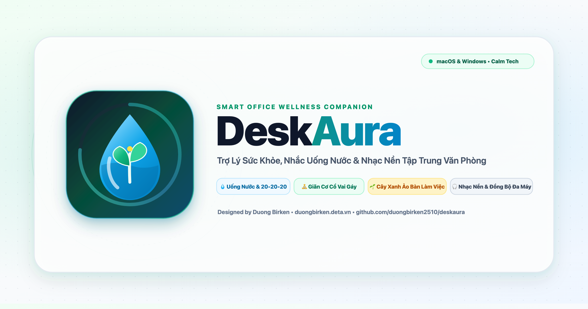
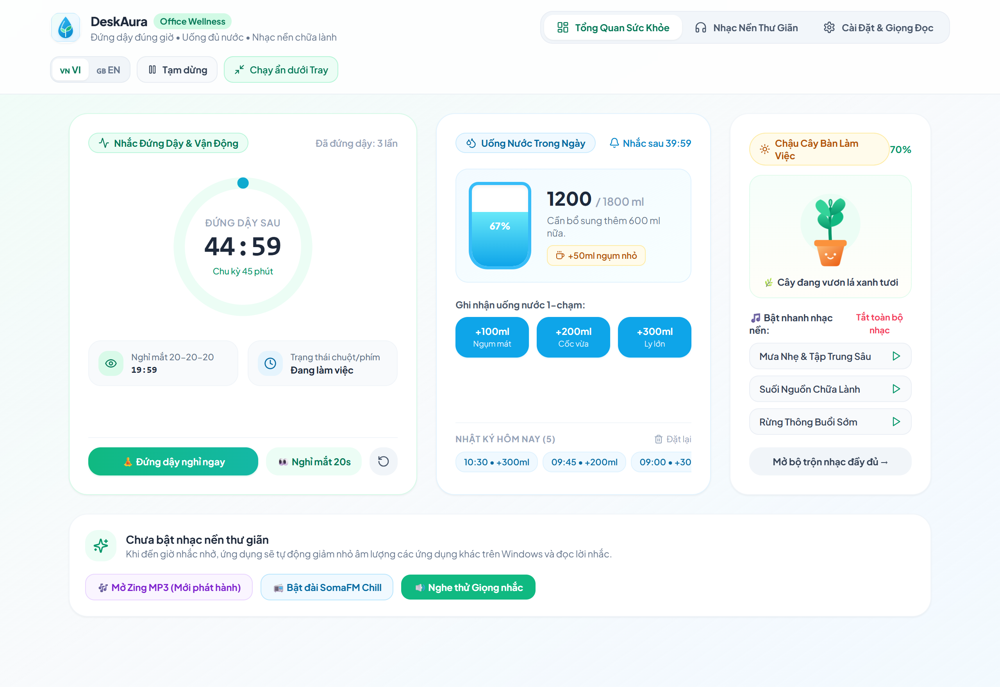
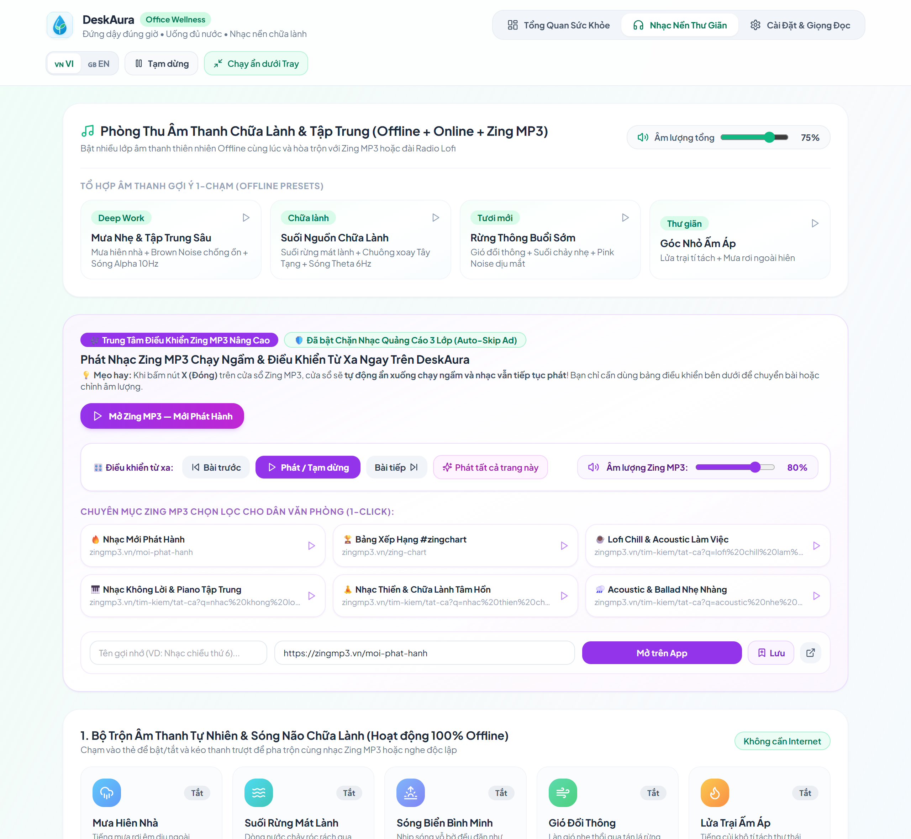

# 📖 CẨM NANG HƯỚNG DẪN SỬ DỤNG DESKAURA (v1.2.7)
### *User Manual & Complete Feature Guide (Tiếng Việt & English)*

<div align="center">
  
</div>

> **Phiên bản áp dụng:** DeskAura `v1.2.7+`  
> **Hệ điều hành hỗ trợ:** Windows 10/11 (`.exe`) • macOS Apple Silicon (`.dmg`) • Linux Ubuntu/Debian (`.deb` / `.AppImage`) • iOS / iPadOS (PWA)  
> **Tác giả & Website chính thức:** **Duong Birken** — [https://duongbirken.deta.vn](https://duongbirken.deta.vn)

---

## 📑 Mục Lục Nhanh / Table of Contents
1. [Phần 1: Cài Đặt & Mở Ứng Dụng Lần Đầu](#phần-1-cài-đặt--mở-ứng-dụng-lần-đầu-windows--macos--linux)
2. [Phần 2: Cách Sử Dụng 4 Tab Chính & Biểu Tượng Khay Hệ Thống](#phần-2-cách-sử-dụng-4-tab-chính--biểu-tượng-khay-hệ-thống)
3. [Phần 3: 6 Cơ Chế Thông Minh Tự Động Của DeskAura](#phần-3-6-cơ-chế-thông-minh-tự-động-của-deskaura)
4. [Phần 4: Bảo Vệ Mắt Phần Cứng (Aura Eye-Shield & Breathing Dimmer)](#phần-4-bảo-vệ-mắt-phần-cứng-aura-eye-shield--breathing-dimmer)
5. [Phần 5: Đồng Bộ Nhiều Máy Tính & Quy Tắc "Chỉ Báo Trên Máy Đang Dùng"](#phần-5-đồng-bộ-nhiều-máy-tính--quy-tắc-chỉ-báo-trên-máy-đang-dùng)
6. [Phần 6: Phòng Thu Nhạc Nền & Giọng Đọc Nhắc Nhở AI](#phần-6-phòng-thu-nhạc-nền--giọng-đọc-nhắc-nhở-ai)
7. [Phần 7: Câu Hỏi Thường Gặp (FAQ & Xử Lý Sự Cố)](#phần-7-câu-hỏi-thường-gặp-faq--xử-lý-sự-cố)

---

## Phần 1: Cài Đặt & Mở Ứng Dụng Lần Đầu (Windows • macOS • Linux)

### 🪟 1.1. Trên Windows 10 / 11
1. Tải file **[`DeskAura_1.2.7_x64-setup.exe`](./Release_Windows/DeskAura_1.2.7_x64-setup.exe)** (bản cài đặt chuẩn) hoặc **[`DeskAura_Portable.exe`](./Release_Windows/DeskAura_Portable.exe)** (bản chạy ngay không cần cài).
2. Nếu Windows hiển thị hộp thoại xanh **"Windows protected your PC" (SmartScreen)**:
   - Bấm vào dòng chữ **`More info`** *(Thông tin thêm)*.
   - Bấm nút **`Run anyway`** *(Vẫn chạy)*.

### 🍎 1.2. Trên macOS (MacBook / iMac M1, M2, M3, M4)
1. Mở file **[`DeskAura_1.2.7_aarch64.dmg`](./Release_macOS/DeskAura_1.2.7_aarch64.dmg)**.
2. Kéo biểu tượng **`DeskAura`** thả vào thư mục **`Applications`**.
3. Nếu mở lần đầu macOS báo *"DeskAura cannot be opened because the developer cannot be verified"*, bạn mở **Terminal** và chạy lệnh sau (chỉ cần chạy 1 lần duy nhất):
   ```bash
   xattr -cr /Applications/DeskAura.app
   ```

### 🐧 1.3. Trên Linux (Ubuntu / Debian / Fedora)
- **Bản `.deb` (Ubuntu/Debian):** Chạy `sudo dpkg -i DeskAura_1.2.7_amd64.deb`.
- **Bản `.AppImage`:** Cấp quyền thực thi `chmod +x DeskAura_1.2.7_amd64.AppImage` rồi nhấp đúp để chạy.

---

## Phần 2: Cách Sử Dụng 4 Tab Chính & Biểu Tượng Khay Hệ Thống



### 🌱 2.1. Tab "Tổng quan" (`Dashboard`)
1. **Vòng Đếm Đồng Tâm Kép (`Dual Activity Rings`):**
   - **Vòng ngoài (Xanh ngọc):** Thời gian đếm ngược đến kỳ **Đứng dậy & Giãn cơ** tiếp theo (mặc định `60:00`).
   - **Vòng trong (Xanh lam):** Thời gian đếm ngược đến kỳ **Nghỉ mắt 20-20-20** tiếp theo (mặc định `20:00`).
   - **Các nút thao tác nhanh dưới vòng đếm:**
     - **`Tạm dừng / Tiếp tục`:** Tạm dừng bộ đếm khi bạn có việc đột xuất.
     - **`Nghỉ đứng dậy ngay`:** Mở ngay màn hình hướng dẫn tập giãn cơ 3 phút.
     - **`Nghỉ mắt 20s`:** Mở ngay màn hình thư giãn điều tiết mắt 20 giây.
     - **`Đặt lại`:** Đưa bộ đếm về lại từ đầu chu kỳ.
2. **Chậu Cây Sinh Thái DeskAura & Cấp Nước (`Hydration & Virtual Plant`):**
   - Bấm các nút **`+50ml`**, **`+100ml`**, **`+200ml`**, **`+300ml`** mỗi khi bạn uống nước.
   - **Hoàn tác 5 giây (`5s Undo`):** Ngay sau khi bấm cộng nước, một thanh nhỏ hiện ra trong 5 giây cho phép bấm **`Hoàn tác`** nếu bạn lỡ bấm nhầm.
   - **4 Cấp độ phát triển của cây theo % nước uống trong ngày:**
     - `< 25%`: 🌱 **Hạt Mầm Khởi Đầu** (Nếu qua 14h chiều chưa uống nước, cây sẽ hiện trạng thái *Khát nước*).
     - `25% – 59%`: 🌿 **Cây Non Vươn Lá**.
     - `60% – 99%`: 🪴 **Cây Xanh Tốt**.
     - `100%+`: 🌸 **Đơm Hoa Rực Rỡ** (kèm hiệu ứng pháo hoa chúc mừng khi đạt mục tiêu).
   - **Chế độ Cú Đêm (`💤 Night-Owl`):** Từ `23:00` đêm đến `05:00` sáng, chậu cây tự động chuyển sang trạng thái ngủ gật cùng bạn.

### 📊 2.2. Tab "Thống kê" (`Analytics`)
- Xem **Điểm Sức Khỏe (`Wellness Score / 100`)** được tính tự động từ 3 trụ cột: *Uống nước (40đ) + Đứng dậy (40đ) + Nghỉ mắt (20đ)*.
- Theo dõi **Chuỗi ngày liên tiếp (`Streak`)**, biểu đồ cột 7 ngày gần nhất và nút **Xuất / Nhập file sao lưu (`.json`)**.

### 🎧 2.3. Tab "Nhạc nền" (`Sound Studio`)
- Kết hợp 10 lớp âm thanh thiên nhiên & sóng não Offline hoặc mở đài **Zing MP3 / Lofi Girl** (xem chi tiết tại [Phần 6](#phần-6-phòng-thu-nhạc-nền--giọng-đọc-nhắc-nhở-ai)).

### ⚙️ 2.4. Tab "Cài đặt" (`Settings`)
- Tùy chỉnh chu kỳ nhắc đứng dậy (`30 / 45 / 60 / 90 phút`), chu kỳ nghỉ mắt (`15 / 20 / 30 phút`), mục tiêu lượng nước (`1500ml – 3500ml`), chế độ thông báo, giọng đọc và đồng bộ nhiều máy.

### 💧 2.5. Biểu Tượng Giọt Nước Trên Thanh Taskbar / Menu Bar (`System Tray`)
Khi bạn bấm nút **`Ẩn xuống khay`** (hoặc bấm dấu `X` đóng cửa sổ), DeskAura thu nhỏ về góc phải thanh Taskbar (Windows) hoặc thanh Menu Bar góc trên (macOS) với `0% CPU/GPU`:
- **Ý nghĩa màu sắc biểu tượng Giọt nước:**
  - 🟢 **Màu Xanh Ngọc (mực nước dâng dần từ 0% ➔ 100%):** Trạng thái làm việc bình thường, mực nước trong giọt biểu thị % mục tiêu uống nước hôm nay.
  - 🟡 **Màu Vàng Hổ Phách (trong 20 giây):** Đang trong 20 giây thư giãn mắt theo quy tắc 20-20-20.
  - 🔴 **Màu Đỏ Ruby:** Đã đến giờ đứng dậy nhưng ứng dụng đang **tự động hoãn** vì bạn đang họp hoặc thuyết trình toàn màn hình.
- **Nhấp chuột phải vào biểu tượng Giọt nước** để mở menu nhanh:
  - Uống nhanh `+200ml` / `+300ml` (không cần mở cửa sổ chính).
  - Bật/Tắt nhanh **Bảo vệ mắt (`Eye-Shield`)**.
  - Bật nhanh **Tổ hợp Nhạc Tập Trung** hoặc **Tắt toàn bộ nhạc**.
  - Tập giãn cơ ngay.

---

## Phần 3: 6 Cơ Chế Thông Minh Tự Động Của DeskAura

DeskAura được thiết kế để bạn **không cần phải bấm nút thủ công** nếu đang bận làm việc:

### 1. 🧘 Tự Động Ghi Nhận `+1 Lần Đứng Dậy` Khi Rời Bàn Làm Việc 3 Phút (`Smart 180s Idle Credit`)
- Khi thông báo nhắc đứng dậy xuất hiện (dù ở chế độ **Toàn màn hình** hay **Nhắc nhẹ ở Taskbar**), nếu bạn **đứng dậy rời khỏi máy tính đi lấy nước / vận động luôn** mà không bấm nút trên màn hình:
  - Cảm biến phần cứng sẽ phát hiện chuột và bàn phím không có thao tác đủ **3 phút (`180 giây`)**.
  - Ứng dụng **tự động cộng `+1 lần đứng dậy`** vào thống kê, **tự động tắt bảng thông báo** và đặt lại đồng hồ về **60 phút** cho chu kỳ mới.

### 2. 🛡️ Chống Cộng Ảo Khi Người Dùng "Lờ Đi" Và Vẫn Làm Việc Tiếp
- Ngược lại, nếu bảng nhắc đứng dậy hiện lên mà bạn **lờ đi** (chuyển cửa sổ khác và **vẫn tiếp tục gõ phím / di chuột làm việc** trong suốt 3 phút đếm ngược) hoặc bấm **Bỏ qua**:
  - Khi hết 3 phút, ứng dụng sẽ tự đóng bảng và đặt lại chu kỳ mới nhưng **KHÔNG cộng `+1 lần đứng dậy`** để đảm bảo thống kê sức khỏe trung thực 100%.

### 3. 🔄 Gộp Chung Thông Báo "Nghi Thức Combo 3-Trong-1" Khi Trùng Giờ
- Khi giờ **Uống nước**, **Nghỉ mắt** và **Đứng dậy** trùng nhau (hoặc cách giờ Đứng dậy dưới 5 phút):
  - DeskAura **không bao giờ bật 2–3 bảng thông báo chồng lên nhau**.
  - Thay vào đó, ứng dụng gộp thành **1 màn hình duy nhất ("Nghi Thức Combo 60 Phút")** tích hợp sẵn cả bài tập giãn cơ lẫn nút **`+ Uống 200ml`** ngay trong cùng một bảng.

### 4. 👀 Chu Kỳ Nghỉ Mắt 20-20-20 Độc Lập Hoàn Toàn Với Bộ Đếm Đứng Dậy
- Cứ mỗi **20 phút**, DeskAura nhắc bạn nhìn xa 6 mét trong **20 giây**.
- Trong lúc bảng Nghỉ mắt đang hiển thị hoặc khi bạn bấm **`Hoãn 5 phút`** / **`Đang họp (Hoãn 15p)`** ở màn hình Nghỉ mắt:
  - Chỉ bộ đếm **Nghỉ mắt** được đặt lại `5 phút` / `15 phút`.
  - Bộ đếm **Đứng dậy** và **Uống nước** vẫn tiếp tục đếm ngược độc lập ở phía sau, không bị đóng băng hay quay lùi.

### 5. 🔇 Ngắt Giọng Đọc Tức Thì (`0ms`) Khi Bấm Tạm Hoãn Hoặc Bỏ Qua
- Khi giọng đọc nhắc nhở đang phát, nếu bạn bấm **`Hoãn 5 phút`**, **`Đang họp (Hoãn 15p)`** hoặc **`Nhấn giữ để bỏ qua`**, âm thanh giọng đọc sẽ **ngắt ngay lập tức** và trả lại âm lượng bình thường cho máy tính.

### 6. 🖥️ Tự Hoãn Khi Họp / Xem Phim Toàn Màn Hình (`Fullscreen Guard`) & Chống "Bóng Đè" Khi Ngủ (`OS Sleep Guard`)
- **Khi đang mở ứng dụng Toàn màn hình (Zoom, Teams, PowerPoint, Xem phim, Chơi game):** DeskAura tự động hoãn mọi popup và âm thanh, chỉ đổi biểu tượng khay hệ thống sang màu **Đỏ Ruby**. Ngay khi bạn thoát chế độ toàn màn hình, lời nhắc mới nhẹ nhàng xuất hiện.
- **Khi gập máy đi ngủ (`Sleep / Hibernate`):** Nếu máy ngủ trên 3 phút, khi mở máy lại đồng hồ đã được làm mới về `60:00`, tuyệt đối không bung thông báo cũ ngay lúc vừa mở màn hình.

---

## Phần 4: Bảo Vệ Mắt Phần Cứng (`Aura Eye-Shield` & `Breathing Dimmer`)

Trong tab **Cài đặt (`Settings`)** ➔ mục **Bảo vệ mắt & Lọc ánh sáng xanh (`Eye-Shield`)**, bạn có thể bật bộ lọc phần cứng can thiệp trực tiếp vào bảng màu `Gamma LUT` của card đồ họa (`0% GPU/RAM`, không tạo lớp phủ làm mờ chữ):

| Chế độ | Thời gian áp dụng | Độ sáng & Độ ấm màu | Phù hợp cho |
| :--- | :--- | :--- | :--- |
| **☀️ Tự động (`Auto`)** | Tự chuyển theo giờ thực tế trong ngày | • `06h–17h`: Sáng `96%`, Ấm `10%`<br>• `18h–21h`: Sáng `88%`, Ấm `28%`<br>• `22h–05h`: Sáng `75%`, Ấm `48%` | Khuyên dùng hằng ngày cho mọi người dùng |
| **🌿 Văn phòng (`Office`)** | Cố định cả ngày | Sáng `92%`, Ấm `20%` | Phòng làm việc nhiều đèn huỳnh quang / màn hình gắt |
| **🌙 Đêm OT (`Night OT`)** | Cố định mức bảo vệ cao | Sáng `75%`, Ấm `50%` | Lập trình viên, người làm việc ban đêm trong phòng tối |

- **Màn hình "Thở" 20 giây (`Breathing Dimmer`):** Khi đến mốc nghỉ mắt 20-20-20, màn hình tự động dịu độ sáng xuống nhẹ nhàng trong 1.5 giây, giữ 20 giây để mắt bạn thả lỏng rồi sáng mượt trở lại.
- **Mẹo cho Designer / Editor chỉnh màu ảnh:** Bạn có thể nhấp chuột phải vào biểu tượng DeskAura dưới thanh Taskbar / Menu Bar ➔ bỏ tích **`🛡️ Bảo vệ mắt (Eye-Shield)`** để trả màn hình về độ chuẩn màu gốc **`100%`** ngay lập tức.

---

## Phần 5: Đồng Bộ Nhiều Máy Tính & Quy Tắc "Chỉ Báo Trên Máy Đang Dùng"

Nếu bạn sử dụng từ **2 máy tính trở lên** (ví dụ: *1 máy PC ở văn phòng + 1 chiếc MacBook*), hãy vào tab **Cài đặt (`Settings`)** ➔ mục **Đồng Bộ Đa Thiết Bị**:

### 🔗 5.1. 3 Cách Kết Nối Các Máy Với Nhau
1. **Đăng nhập bằng Google (`Sign in with Google`):** Nhấn 1 chạm, trình duyệt mở trang xác thực Google và tự động kết nối mọi máy dùng chung tài khoản Gmail.
2. **Đăng nhập bằng Email & Mật khẩu:** Tạo tài khoản hoặc đăng nhập trực tiếp trong ứng dụng.
3. **Mã Đồng Bộ Nhanh 6 Ký Tự (`Aura Sync Code`):** Nhập cùng một mã 6 ký tự (ví dụ `AURA88`) trên cả 2 máy để đồng bộ ngay mà không cần tài khoản.

### 🎯 5.2. Cơ Chế "Single-Leader Active Routing" (Chỉ Thông Báo Trên Máy Đang Sử Dụng)
Khi 2 máy đã đồng bộ với nhau:
- **Trường hợp 1 (Máy 1 đang dùng, Máy 2 để không):**
  - Khi đến giờ nhắc Đứng dậy, Nghỉ mắt hoặc Uống nước, **chỉ duy nhất Máy 1** (máy bạn đang thao tác chuột/bàn phím) hiện thông báo và phát âm thanh.
  - **Máy 2** tự động đặt lại đồng hồ theo Máy 1 trong **im lặng tuyệt đối**, không bật thông báo làm phiền.
- **Trường hợp 2 (Cả 2 máy đều đang mở và thao tác qua lại):**
  - Hệ thống tự động chọn **duy nhất 1 máy vừa có thao tác chuột/phím gần nhất (tính tới từng giây)** làm **Máy Chính** để phát thông báo và cộng thống kê — đảm bảo không bao giờ kêu chuông cùng lúc trên cả 2 máy và không bao giờ bị cộng gấp đôi (`x2`) số phút tập trung hay số lần đứng dậy.
- **Trường hợp 3 (Cả 2 máy đều đang nghỉ `>= 3 phút`):**
  - Cả 2 máy đều giữ im lặng hoàn toàn và tự nạp lại chu kỳ mới khi bạn chạm chuột quay lại làm việc.

---

## Phần 6: Phòng Thu Nhạc Nền & Giọng Đọc Nhắc Nhở AI



### 🎵 6.1. Bàn Trộn 10 Lớp Âm Thanh Offline & Đài Nhạc Trực Tuyến
- **10 Lớp âm thanh chạy 100% Offline (Không tốn mạng, không bị chặn bởi tường lửa công ty):**
  - *Thiên nhiên:* Mưa hiên nhà, Suối rừng, Sóng biển vỗ bờ, Gió đồi thông, Lửa trại tí tách.
  - *Chữa lành & Tập trung:* Chuông xoay Tây Tạng (`432Hz/528Hz`), Sóng não Alpha (`10Hz` — Tập trung), Sóng não Theta (`6Hz` — Thiền sâu), Nhiễu Nâu (`Brown Noise`), Nhiễu Hồng (`Pink Noise`).
  - Bạn có thể bật cùng lúc nhiều âm thanh và kéo thanh trượt âm lượng riêng cho từng lớp, hoặc chọn nhanh các **Preset có sẵn** (*Mưa Quốc Dân, Tập Trung Sâu, Thiền Định...*).
- **Đài Nhạc Trực Tuyến Theo Ngôn Ngữ (`Bilingual Audio Hub`):**
  - Khi chọn giao diện **Tiếng Việt (`🇻🇳`):** Tích hợp trình phát **Zing MP3** chạy ngầm kèm bộ lọc tự động tắt tiếng khi có quảng cáo âm thanh (`Smart Audio Ad-Guard`).
  - Khi chọn giao diện **Tiếng Anh (`🇬🇧`):** Tích hợp các kênh **Global Lofi & SoundCloud** (*Lofi Girl, Chillhop, Code Radio, Ambient Sleeping Pill*).
- **Phát nhạc từ máy tính:** Bấm **`Mở file nhạc từ máy`** để phát các file `.mp3`, `.wav`, `.ogg`, `.flac`, `.m4a` sẵn có trên ổ cứng.

### 🗣️ 6.2. Giọng Đọc Nhắc Nhở AI & Tự Giảm Nhạc Nền (`Audio Ducking`)
- Trong **Cài đặt (`Settings`)**, bạn có thể chọn:
  - **Giọng Nữ AI tự nhiên (Tiếng Việt)**, **Giọng Nam AI trầm ấm (Tiếng Việt)**, **Giọng AI Tiếng Anh**, hoặc **Tự nhập câu nhắc riêng (`Custom TTS`)**.
  - Chế độ **Tắt giọng đọc (Chỉ hiện Popup)** nếu đang ngồi trong văn phòng cần yên tĩnh tuyệt đối.
- **Tự động giảm nhỏ nhạc nền (`Smart Audio Ducking`):** Mỗi khi giọng đọc nhắc nhở cất lên, DeskAura tự động giảm nhỏ âm lượng nhạc nền xuống `20%` để bạn nghe rõ lời nhắc, sau đó từ từ tăng mượt trở lại.

---

## Phần 7: Câu Hỏi Thường Gặp (FAQ & Xử Lý Sự Cố)

**❓ 1. Làm sao để ứng dụng cập nhật lên phiên bản mới?**
- DeskAura tích hợp cơ chế **Cập nhật ngầm tự động (`Silent Background OTA`)**. Khi có bản mới trên GitHub, ứng dụng tự tải ngầm trong nền mà không hiện popup làm phiền. Khi tải xong, một **chấm xanh ngọc nhỏ** sẽ sáng lên ở mục **`Cài đặt`** — bạn chỉ cần bấm **`Khởi động lại và Cập nhật`** (hoặc lần bật máy tiếp theo ứng dụng sẽ tự áp dụng).

**❓ 2. Tôi chọn "Nhắc nhẹ ở Taskbar (Gentle Mode)" thì làm sao biết đã đến giờ nghỉ?**
- Khi đến hạn ở chế độ Nhắc nhẹ, ứng dụng sẽ phát thông báo góc màn hình + lời nhắc thoại nhẹ nhàng + hiển thị thanh banner màu xanh ngọc ở đầu cửa sổ ứng dụng (không bung cửa sổ đè lên phần mềm bạn đang gõ). Nếu bạn đứng dậy rời máy đủ 3 phút, ứng dụng tự động cộng `+1 lần nghỉ` và tự tắt thanh nhắc.

**❓ 3. Dữ liệu sức khỏe của tôi có được bảo mật không?**
- **An toàn 100%.** Toàn bộ dữ liệu thống kê lưu trên máy tính đều được mã hóa gắn với mã phần cứng riêng của máy bạn (`AES/XOR Hardware-Bound Vault enc:v2:`). Khi truyền qua mạng LAN nội bộ, gói tin được ẩn danh hóa một chiều (`rk2_<32hex>`) và ký xác thực chống giả mạo.

---

<div align="center">

**🌐 Website Tác giả:** [**https://duongbirken.deta.vn**](https://duongbirken.deta.vn) • **🐞 Hỗ trợ & Góp ý:** [**GitHub Issues**](https://github.com/duongbirken2510/deskaura/issues)

</div>

