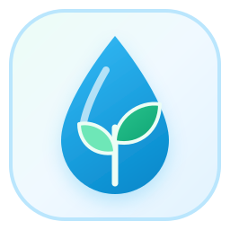
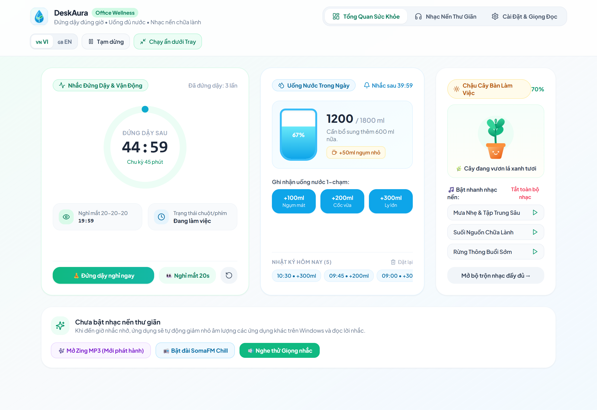
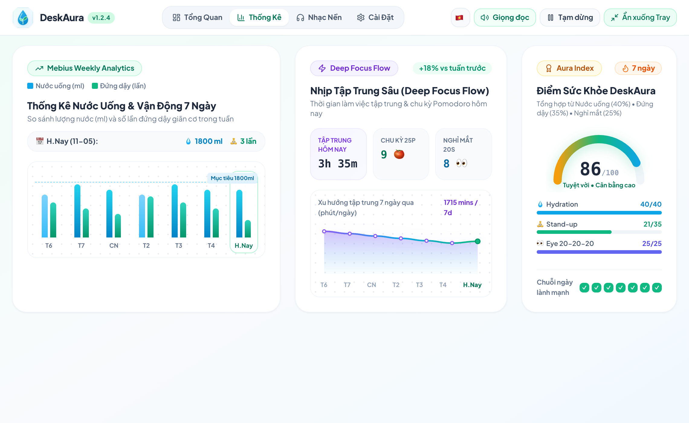
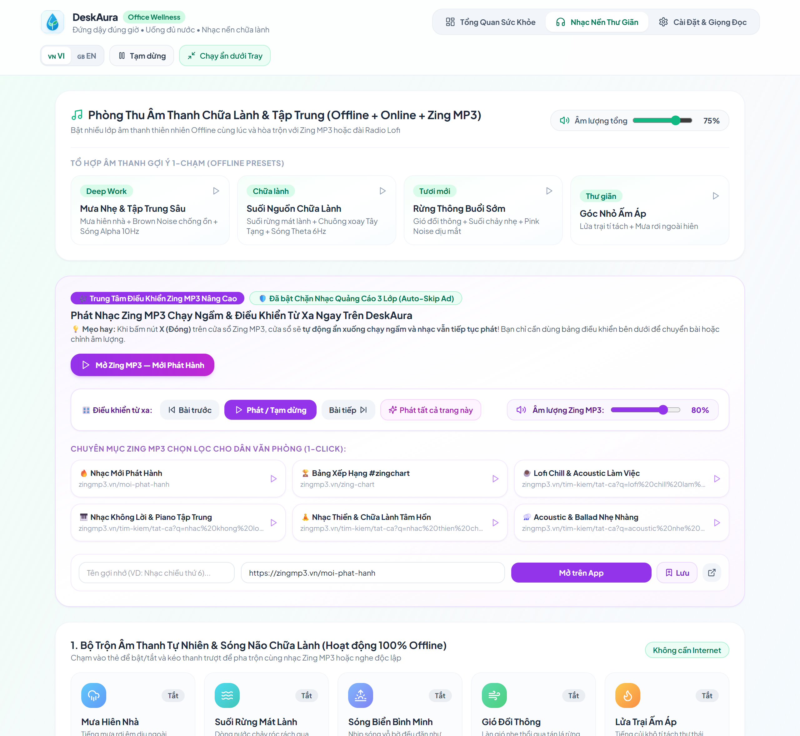
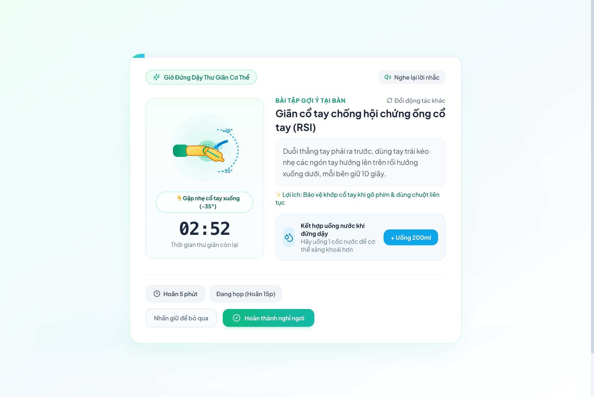
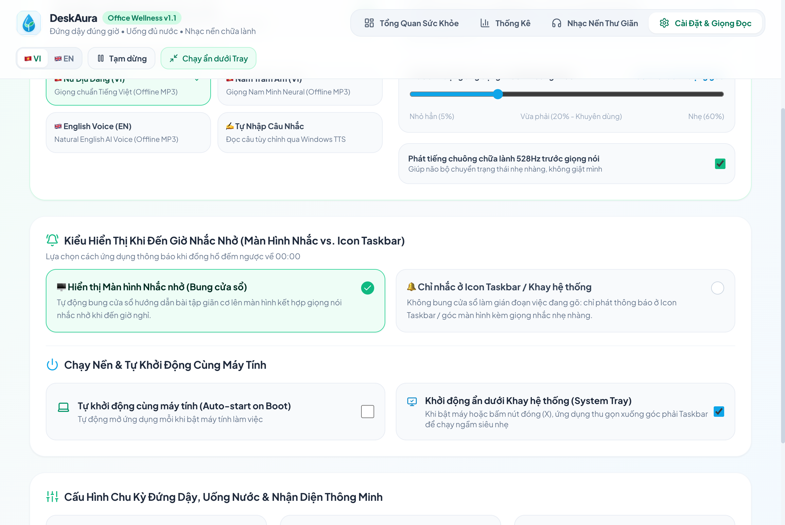
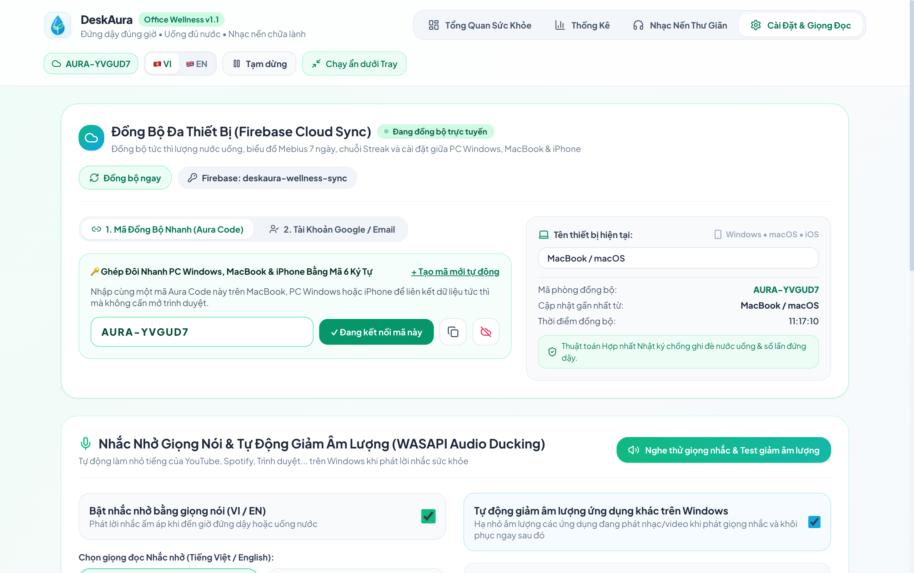

<div align="center">



# 🌱 DeskAura v1.1

### **Smart Office Wellness & Ambient Focus Companion (Windows • macOS • iOS)**
*Trợ Lý Sức Khỏe Văn Phòng & Không Gian Nhạc Nền Chữa Lành (Tiếng Việt & English)*

[](https://github.com/duongbirken2510/deskaura/releases)
[-0078D6?style=for-the-badge&logo=windows)](./Release_Windows)
[-000000?style=for-the-badge&logo=apple)](./Release_macOS)
[](https://tauri.app/)
[](#)
[](./LICENSE)

[**🚀 Có Gì Mới Ở Bản v1.1**](#-có-gì-mới-trong-phiên-bản-deskaura-v11-whats-new) • [**📥 Tải Bản Windows (`.exe`)**](#-1-tải--cài-đặt-trên-windows-1011) • [**🍎 Tải Bản macOS (`.dmg`)**](#-2-tải--cài-đặt-trên-macos-macbook--imac) • [**📱 Hướng Dẫn Bản iOS / iPadOS**](#-3-cài-đặt--triển-khai-trên-ios--ipados-iphone--ipad)

</div>

---

## 🚀 Có Gì Mới Trong Phiên Bản DeskAura v1.1 (What's New in v1.1)

Phiên bản **DeskAura v1.1** tập trung tối ưu hóa trải nghiệm thị giác tối giản, tinh gọn luồng âm thanh và trao toàn quyền kiểm soát cách hiển thị lời nhắc cho người dùng:

1. 📊 **Tách Riêng Tab `Thống Kê` (`Analytics`) Độc Lập:**
   - Tách bộ 3 biểu đồ chuyên sâu **Mebius 7 Ngày** (*Lượng nước & Vận động 7 ngày*, *Nhịp tập trung sâu Deep Focus Flow*, *Chỉ số Aura Index 0–100*) sang tab **`Thống Kê`** riêng biệt.
   - Giúp trang **`Tổng Quan Sức Khỏe`** hiển thị trọn vẹn **3 thẻ cốt lõi trên 1 màn hình duy nhất**, thoáng mắt và không cần cuộn trang.
2. 🎶 **Tinh Gọn Trang `Nhạc Nền Thư Giãn` — Đưa Zing MP3 Lên Đầu Trang:**
   - Đưa **Trung Tâm Điều Khiển Zing MP3 Nâng Cao** (hỗ trợ phát ngầm + lọc quảng cáo 3 lớp `Smart Audio Ad-Guard`) lên vị trí đầu tiên để thao tác tức thì.
   - Loại bỏ toàn bộ khu vực kênh đài FM và danh sách liên kết kho nhạc ngoài rườm rà, chỉ giữ lại những công cụ thiết thực nhất: **Zing MP3** + **Bộ Trộn 10 Lớp Âm Thanh Thiên Nhiên & Sóng Não Offline** (kèm nút mở file nhạc `.mp3/.wav/.flac` từ máy).
3. 🔔 **Tùy Chọn Linh Hoạt Kiểu Nhắc Nhở (`Màn Hình Nhắc` vs. `Icon Taskbar`):**
   - Bổ sung mục **Kiểu Hiển Thị Khi Đến Giờ Nhắc Nhở** trong phần Cài Đặt với 2 chế độ:
     - **🖥️ Hiển thị Màn hình Nhắc nhở (Bung cửa sổ):** Tự động bung cửa sổ hướng dẫn bài tập giãn cơ lên màn hình kết hợp giọng đọc AI.
     - **🔔 Chỉ nhắc ở Icon Taskbar / Khay hệ thống:** Không bung cửa sổ làm gián đoạn công việc đang gõ dở — chỉ nháy sáng biểu tượng dưới Taskbar/Dock, hiện thông báo góc màn hình kèm giọng nhắc nhẹ nhàng.
4. ☁️ **Đồng Bộ Đa Thiết Bị Thời Gian Thực (`Firebase Cloud Sync` & `Aura Sync Code`):**
   - Kết nối liền mạch giữa **PC Windows, MacBook và iPhone/iPad** qua cơ sở dữ liệu **Google Cloud Firestore (`Offline-First`)**.
   - Hỗ trợ song song **Mã Đồng Bộ Nhanh 6 ký tự (`Aura Code`, VD: `AURA-YVGUD7`)** và **Tài khoản Google / Email**.
   - Tích hợp thuật toán **Hợp nhất Nhật ký (`Deduplicated Log Union`)** chống ghi đè lịch sử uống nước và số lần đứng dậy khi mở nhiều thiết bị cùng lúc.

---

## 📸 Ảnh Chụp Giao Diện DeskAura v1.1 / Screenshots

### 1. Tổng Quan Sức Khỏe Tinh Gọn (`Minimalist Wellness Dashboard`)
Giao diện Bento 3 cột gọn gàng trong 1 khung nhìn: **Vòng Đếm Đồng Tâm Kép** (*Đứng dậy & Nghỉ mắt 20-20-20*), **Trạm Cấp Nước Cơ Thể** và **Chậu Cây DeskAura & Phím Tắt Nhạc Nền**.



---

### 2. Tab Thống Kê Chuyên Sâu Mebius 7 Ngày (`7-Day Mebius Analytics Tab`)
Theo dõi trực quan biểu đồ **Lượng nước uống (ml) & Số lần đứng dậy 7 ngày**, **Nhịp Tập Trung Sâu (`Deep Focus Flow` quy đổi chu kỳ 🍅 Pomodoro)** và **Điểm Sức Khỏe `Aura Index (0–100)`**.



---

### 3. Phòng Thu Nhạc Nền & Trung Tâm Zing MP3 Chống Quảng Cáo (`Zing MP3 Hub & Offline Soundscape Mixer`)
Đặt **Trung Tâm Điều Khiển Zing MP3 Nâng Cao** ngay đầu trang cùng **Bộ Trộn 10 Lớp Âm Thanh Thiên Nhiên & Sóng Não Offline** và trình phát nhạc trực tiếp từ máy tính.



---

### 4. Màn Hình Nhắc Đứng Dậy & Hướng Dẫn Giãn Cơ Tại Bàn (`Guided Stretch & Hydration Break`)
Màn hình nhắc nghỉ ngơi dịu mắt với hoạt ảnh bài tập cổ - vai - gáy - cổ tay 60fps trực quan, kết hợp nút ghi nhận uống nước nhanh `+200ml` và nút hoãn thông minh khi đang họp.



---

### 5. Tùy Chọn Nhắc Nhở (Màn Hình Nhắc vs. Icon Taskbar) & Giảm Âm Lượng Tự Động (`Reminder Modes & Audio Ducking`)
Lựa chọn linh hoạt giữa **Bung màn hình nhắc nhở** hoặc **Chỉ nhắc ở Icon Taskbar / Khay hệ thống**, kết hợp công nghệ **Windows WASAPI Audio Ducking** tự động hạ nhỏ âm lượng ứng dụng khác xuống 20% khi phát giọng đọc AI.



---

### 6. Đồng Bộ Đa Thiết Bị Thời Gian Thực (`Firebase Cloud Sync & 6-Digit Aura Code`)
Ghép đôi tức thì giữa **PC Windows, MacBook và iPhone/iPad** bằng **Mã Đồng Bộ Nhanh (`Aura Code` 6 ký tự)** hoặc **Tài khoản Google / Email**, tự động hợp nhất lịch sử uống nước và biểu đồ Mebius 7 ngày mà không sợ mất dữ liệu khi Offline.



---

## ✨ Tính Năng Nổi Bật / Key Features

| Trụ cột | Chi tiết tính năng |
| :--- | :--- |
| 🧘 **Nhắc Đứng Dậy & Nghỉ Mắt 20-20-20** | • Tự động nhận diện thời gian rời máy (`Idle Detection` trên Windows & macOS `IOHIDSystem`) để tự đặt lại đồng hồ.<br>• Tự động hoãn lời nhắc khi bạn đang họp hoặc thuyết trình toàn màn hình (`Fullscreen Detection`).<br>• **2 chế độ nhắc nhở linh hoạt:** Bung màn hình bài tập giãn cơ (`Overlay Mode`) hoặc Chỉ nháy Icon Taskbar & thông báo góc màn hình (`Gentle Taskbar Mode`).<br>• **Hoạt ảnh hướng dẫn giãn cơ đa khớp 60fps** (cổ, vai gáy, cổ tay chống RSI, cột sống và thư giãn mắt 20s) kèm huy hiệu nhịp tập trực tiếp. |
| 📊 **Tab Thống Kê Mebius Analytics** | • **Vòng Đếm Đồng Tâm Kép (`Dual Activity Rings`):** Theo dõi song song chu kỳ Đứng dậy và Nghỉ mắt 20-20-20.<br>• **Biểu Đồ Nước Theo Giờ & Lịch Sử 7 Ngày:** Phân tích lượng nước theo khung giờ (`08h` $\rightarrow$ `18h+`) và so sánh Nước uống + Vận động suốt 7 ngày.<br>• **Nhịp Tập Trung Sâu (`Deep Focus Sparkline`) & Điểm `Aura Score (0-100)`:** Quy đổi số chu kỳ Pomodoro 🍅, chấm điểm cân bằng sức khỏe và theo dõi chuỗi ngày liên tiếp (`Habit Streak`). |
| 💧 **Nhắc Uống Nước Thông Minh** | • Ghi nhận lượng nước 1-chạm (`+100ml`, `+200ml`, `+300ml`) trên giao diện hoặc ngay từ menu chuột phải dưới **System Tray**.<br>• Tự động gộp lời nhắc uống nước vào giờ nghỉ đứng dậy (`Combo Reminder`) để không làm gián đoạn sự tập trung.<br>• Nuôi dưỡng **Chậu cây DeskAura** nảy mầm và nở hoa khi bạn uống đủ nước. |
| 🎵 **Zing MP3 Ad-Guard & Phòng Thu Nhạc Nền** | • **Zing MP3 Chạy Ngầm & Chống Quảng Cáo 3 Lớp (`Smart Audio Ad-Guard`):** Đóng cửa sổ (`X`) nhạc vẫn phát ngầm, điều khiển qua bài/tạm dừng/tắt hẳn ngay từ đầu trang Nhạc Nền hoặc từ **Khay hệ thống (System Tray)**, tự động bỏ qua quảng cáo âm thanh.<br>• **10 lớp âm thanh Offline:** Mưa hiên nhà, Suối rừng, Sóng biển, Gió đồi thông, Lửa trại, Chuông xoay Tây Tạng (432Hz/528Hz), Sóng não Alpha (10Hz), Sóng não Theta (6Hz), Brown Noise & Pink Noise + Mở file nhạc `.mp3/.wav/.flac` từ máy tính. |
| 🔊 **Giọng Nhắc AI (VI/EN) & WASAPI Audio Ducking** | • Bộ giọng đọc AI Offline MP3 tự nhiên bằng cả **Tiếng Việt** (*Nữ Dịu Dàng*, *Nam Trầm Ấm*) và **Tiếng Anh** (*English Neural Voice*).<br>• Can thiệp trực tiếp vào **Windows Core Audio API (WASAPI)** để hạ nhỏ âm lượng các ứng dụng khác (YouTube, Spotify, Chrome...) xuống `20%` trong vài giây đọc lời nhắc, sau đó khôi phục lại 100% mượt mà. |
| 🖥️ **Tích Hợp Sâu Hệ Điều Hành (Windows & macOS)** | • Thu gọn xuống **System Tray / Menu Bar** khi bấm nút `X` để chạy ngầm siêu nhẹ (~15 MB RAM).<br>• Menu chuột phải tại System Tray hỗ trợ cả **Tiếng Việt & Tiếng Anh**, cho phép bật/tắt nhạc Zing MP3, qua bài, ghi nhận uống nước nhanh 1-click.<br>• Hỗ trợ **Tự khởi động cùng máy (`Auto-start on Boot`)** qua Windows Registry và macOS `LaunchAgents`. |

---

## 📥 Hướng Dẫn Tải & Cài Đặt (Windows • macOS • iOS)

### 🪟 1. Tải & Cài Đặt Trên Windows 10/11
Bạn có thể tải trực tiếp trong thư mục [`Release_Windows/`](./Release_Windows) hoặc tại mục [**Releases**](https://github.com/duongbirken2510/deskaura/releases):

1. **[`DeskAura_1.1.0_x64-setup.exe`](./Release_Windows/DeskAura_1.1.0_x64-setup.exe)** *(~2.9 MB)* — Bộ cài đặt chuẩn cho Windows 10/11 (Tự động tạo biểu tượng Desktop & Start Menu).
2. **[`DeskAura_Portable.exe`](./Release_Windows/DeskAura_Portable.exe)** *(~10.8 MB)* — Bản chạy ngay lập tức (Portable), không cần cài đặt.

> 💡 **Lưu ý khi mở lần đầu trên Windows (Windows SmartScreen):**
> Do ứng dụng là dự án mã nguồn mở phát hành độc lập (chưa đăng ký chứng chỉ thương mại EV Code Signing của Microsoft), trong lần chạy đầu tiên Windows Defender có thể hiển thị hộp thoại màu xanh **"Windows protected your PC"**.
> 👉 Bạn chỉ cần bấm vào **`More info`** *(Thông tin thêm)* $\rightarrow$ chọn **`Run anyway`** *(Vẫn chạy)* để mở ứng dụng bình thường.

---

### 🍎 2. Tải & Cài Đặt Trên macOS (MacBook / iMac)
Bộ cài đặt dành cho máy Mac (Apple Silicon M1/M2/M3/M4) nằm sẵn trong thư mục [`Release_macOS/`](./Release_macOS):

1. Tải và mở file **[`DeskAura_1.1.0_aarch64.dmg`](./Release_macOS/DeskAura_1.1.0_aarch64.dmg)** *(~4.3 MB)*.
2. Kéo biểu tượng **`DeskAura`** thả vào thư mục **`Applications`**.

> 💡 **Lưu ý khi mở lần đầu trên máy MacBook khác (macOS Gatekeeper):**
> Vì ứng dụng là bản phân phối mã nguồn mở độc lập (chưa qua cổng công chứng trả phí Apple Notarization), khi tải qua mạng về máy Mac mới, macOS có thể hiển thị cảnh báo chưa xác minh nhà phát triển hoặc báo *"DeskAura is damaged and can't be opened"*. Bạn chỉ cần thực hiện **1 trong 2 cách sau (chỉ làm 1 lần duy nhất khi mới cài)**:
> - **Cách 1 (Nhanh nhất bằng Terminal):** Mở **Terminal** và chạy lệnh gỡ cờ cách ly cho ứng dụng:
>   ```bash
>   xattr -cr /Applications/DeskAura.app
>   ```
> - **Cách 2 (Trong Cài đặt hệ thống):** Mở **System Settings (Cài đặt hệ thống)** $\rightarrow$ **Privacy & Security (Quyền riêng tư & Bảo mật)** $\rightarrow$ kéo xuống dưới cùng bấm **`Open Anyway` (Vẫn mở)**.

---

### 📱 3. Cài Đặt & Triển Khai Trên iOS / iPadOS (iPhone & iPad)
**DeskAura** được xây dựng trên nền tảng **Tauri v2 + React Responsive Bento UI**, hỗ trợ triển khai lên iPhone / iPad theo **2 phương thức**:

#### Phương thức A: Dùng ngay dạng Ứng dụng Web Độc Lập (PWA — Không cần cáp hay Xcode)
1. Trên máy tính cùng mạng Wi-Fi, chạy máy chủ giao diện:
   ```bash
   npm run dev -- --host
   ```
2. Mở trình duyệt **Safari** trên iPhone hoặc iPad, truy cập địa chỉ IP hiển thị trên màn hình (ví dụ: `http://192.168.1.x:1420`).
3. Bấm nút **Chia sẻ (Share)** ở thanh dưới cùng Safari $\rightarrow$ chọn **`Thêm vào Màn hình chính` (`Add to Home Screen`)** $\rightarrow$ bấm **Thêm (`Add`)**.
4. Biểu tượng **DeskAura** sẽ xuất hiện ngay trên màn hình chính iOS như một ứng dụng độc lập, đầy đủ bộ đếm nhắc nhở, biểu đồ Mebius, hoạt ảnh bài tập và bộ trộn âm thanh chữa lành Offline.

#### Phương thức B: Biên dịch gói cài đặt iOS Native (`.ipa`) qua Xcode & Tauri v2 Mobile
Nếu bạn có máy Mac cài sẵn **Xcode** và tài khoản Apple ID cá nhân (Free Provisioning):
```bash
# 1. Khởi tạo dự án Xcode cho iOS (chỉ chạy lần đầu)
npm run tauri ios init

# 2. Chạy thử trực tiếp lên iPhone thật hoặc iOS Simulator
npm run tauri ios dev

# 3. Xuất gói cài đặt .ipa qua Xcode Archive
npm run tauri ios build
```
> 📌 *Lưu ý trên iOS khi cài qua Apple ID cá nhân:* Trên iPhone, vào **Cài đặt (`Settings`)** $\rightarrow$ **Cài đặt chung (`General`)** $\rightarrow$ **Quản lý VPN & Thiết bị (`VPN & Device Management`)** $\rightarrow$ chọn email Apple ID của bạn và bấm **Tin cậy (`Trust`)** để mở ứng dụng.

---

## 🛠️ Phát Triển Từ Mã Nguồn / Build From Source

```bash
# 1. Cài đặt thư viện phụ thuộc
npm install

# 2. Chạy ứng dụng ở chế độ phát triển (Desktop App)
npm run tauri dev

# 3. Đóng gói bộ cài đặt cho macOS (.app & .dmg)
npm run tauri build

# 4. Đóng gói bộ cài đặt .exe chuẩn cho Windows
npm run tauri build -- --bundles nsis
```

---

## 📄 Giấy Phép / License

Dự án được phân phối dưới giấy phép mã nguồn mở [**MIT License**](./LICENSE).
