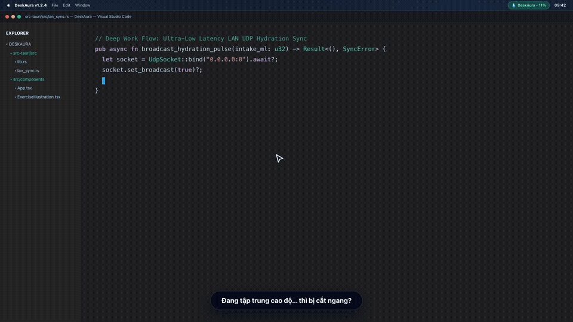
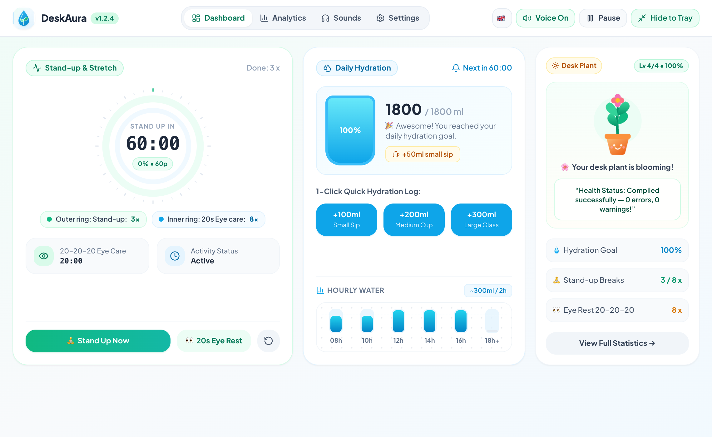
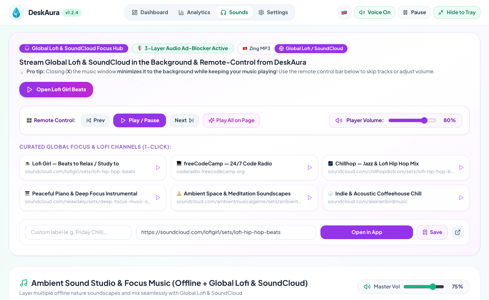
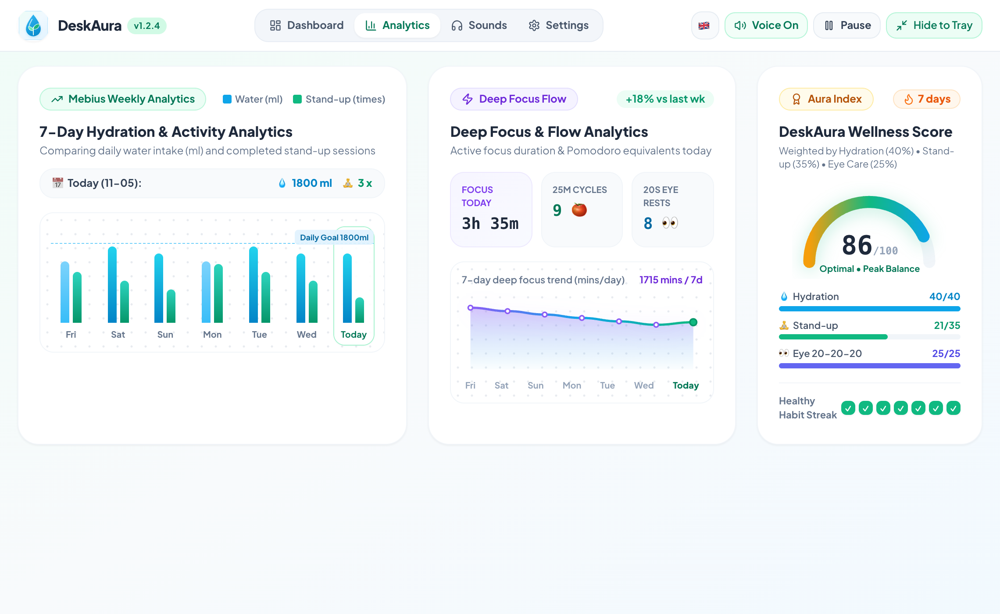
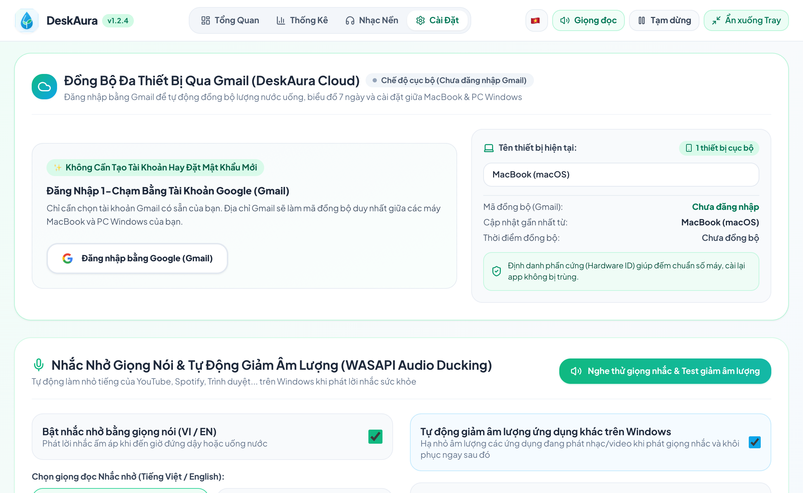

<div align="center">


# 🌱 DeskAura v1.2.4

### **Smart Office Wellness & Ambient Focus Companion (Windows • macOS • iOS)**
*Trợ Lý Sức Khỏe Văn Phòng Tĩnh Lặng & Không Gian Nhạc Nền Chữa Lành (Tiếng Việt & English)*

[](https://github.com/duongbirken2510/deskaura/releases)
[-0078D6?style=for-the-badge&logo=windows)](./Release_Windows)
[-000000?style=for-the-badge&logo=apple)](./Release_macOS)
[](https://tauri.app/)
[](#)
[](https://duongbirken.deta.vn)
[](./LICENSE)

[**🎬 Video Demo 45s**](#-video-demo-45-giây--45-second-product-showcase) • [**🚀 Có Gì Mới Ở v1.2.4 (VI/EN)**](#-có-gì-mới-trong-phiên-bản-deskaura-v124--whats-new-v120--v124) • [**📸 Giao Diện Tiếng Việt & English**](#-ảnh-chụp-giao-diện-v124-tiếng-việt--english--bilingual-screenshots) • [**📥 Tải Về (Windows / macOS)**](#-hướng-dẫn-tải--cài-đặt-windows--macos--ios) • [**👨‍💻 Tác Giả & Liên Hệ**](#-tác-giả--liên-hệ--author--contact)

</div>

---

## 🎬 Video Demo 45 Giây / 45-Second Product Showcase

<div align="center">

[](./docs/media/deskaura_demo_45s.mp4)

🎥 **[▶️ Nhấn vào đây để mở Video Demo 45 giây Full HD 1080p60 có âm thanh (`deskaura_demo_45s.mp4`)](./docs/media/deskaura_demo_45s.mp4)**

</div>

> **Kịch bản 5 phân cảnh trong Video Demo (`00:00 – 00:45`):**
> - **`00:00 – 00:05` (The Annoying Interruption):** Đang tập trung code trong VS Code thì bị hộp thoại nhắc nhở truyền thống chặn đứng màn hình.
> - **`00:05 – 00:12` (The Silent Alternative):** Chuyển sang **DeskAura Bento UI** — trợ lý sức khỏe tĩnh lặng, bảo vệ luồng công việc sâu (*Deep Work*).
> - **`00:12 – 00:20` (Healing Gamification):** Ghi nhận uống nước 1-chạm `+200ml`, bình nước dâng cao và **Chậu cây chữa lành** vươn lá xanh tươi.
> - **`00:20 – 00:36` (Smart Context & Night Mode):** Tự động nhận biết làm việc khuya (`23:15`), kích hoạt âm thanh giảm chấn và trạng thái cây ngủ **`💤 Sập nguồn rồi sếp ơi!`**.
> - **`00:36 – 00:45` (Outro & Call to Action):** Thu gọn mượt mà vào biểu tượng **Giọt Nước trên Menu Bar / System Tray**, sẵn sàng tải về cho **Windows** & **macOS**.

---

## 🚀 Có Gì Mới Trong Phiên Bản DeskAura v1.2.4 / What's New (`v1.2.0` $\rightarrow$ `v1.2.4`)

### 🇻🇳 Tóm Tắt Nâng Cấp Mới (Bản Tiếng Việt)

1. 🤫 **Cập Nhật Ngầm Không Làm Phiền (`Silent Background OTA` & `Two-Phase Garbage Collection`):**
   - **Tải ngầm hoàn toàn (`stage_silent_update`):** Khi khởi động hoặc định kỳ 30 phút, DeskAura tự động tải trước bản cập nhật mới về thư mục tạm (`%TEMP%\DeskAura_Updates` hoặc `/tmp/DeskAura_Updates`) mà **không bật bất kỳ hộp thoại popup nào chặn màn hình**.
   - **Điểm neo thị giác tinh tế (`Subtle Visual Nudge`):** Khi gói cập nhật đã sẵn sàng, chỉ hiển thị chấm tròn xanh ngọc trên biểu tượng `⚙️ Cài Đặt` và nút nhỏ `Khởi động lại (v1.2.4)` trên thanh Header.
   - **Tự động dọn rác sau cập nhật (`cleanup_old_update_files`):** Tự động xóa các file cài đặt `.exe` / `.dmg` cũ trong thư mục tạm ngay khi lên phiên bản mới, giải phóng 100% dung lượng ổ cứng.
2. 🔐 **Mã Hóa Lịch Sử Sức Khỏe Gắn Phần Cứng (`Hardware-Bound Local Storage Encryption enc:v1:`):**
   - Mã hóa toàn bộ lịch sử uống nước, thống kê 7 ngày và cài đặt người dùng trên máy tính theo chuẩn `enc:v1:<base64>` gắn liền với mã định danh phần cứng (`Hardware ID`), kèm cơ chế tự động chuyển đổi không mất dữ liệu (`Zero-Data-Loss Migration`).
3. ⚡ **Đồng Bộ Đa Thiết Bị Lai 4 Tầng (`4-Tier Hybrid Sync` với `Zero-Config LAN UDP <5ms`):**
   - Kết hợp đồng bộ tức thì qua mạng nội bộ **LAN UDP Broadcast cổng `45888` (`<5ms`)** giữa PC Windows và MacBook cùng Wi-Fi với **Google Cloud Firestore** và **Mã Đồng Bộ 6 ký tự (`Aura Code`)**.
4. 💧 **Biểu Tượng Khay Hệ Thống Hình Giọt Nước Dâng Theo % (`Liquid-Fill Water Droplet Tray Icon`):**
   - Biểu tượng trên System Tray / macOS Menu Bar được nâng cấp thành **Giọt Nước nghệ thuật** có mực chất lỏng bên trong tự động dâng cao (`0% -> 100%`) và đổi màu theo trạng thái cơ thể (*Xanh lam* khi đang nạp nước, *Xanh ngọc* khi đạt 100%, *Vàng hổ phách* khi ngồi lâu quá 45 phút).
5. 🧠 **Nhận Biết Ngữ Cảnh Thông Minh & Ma Trận Âm Lượng Theo Giờ:**
   - **Tự động đặt lại sau 3 phút rời máy (`3-Minute Natural Idle Reset`):** Rời bàn làm việc $\ge 3$ phút tự động tính là 1 lần đứng dậy và đặt lại đồng hồ 60 phút.
   - **Bảo vệ khi gập máy & Họp toàn màn hình (`OS Sleep/Hibernate & Fullscreen Guard`):** Tự động hoãn lời nhắc khi đang thuyết trình/họp toàn màn hình và tự đặt lại chu kỳ khi mở máy sau giấc ngủ dài.
   - **Tự động ẩn nút Hoàn tác nước sau 5 giây (`Auto-Hiding 5s Undo`)** & **Khóa trạng thái khát khi đã đạt 100% nước**.
6. 🌐 **Song Ngữ Toàn Diện (Tiếng Việt & English) — Tự Động Chuyển Đổi Nền Tảng Nhạc:**
   - Khi chọn **Tiếng Việt (`🇻🇳`)**: Hiển thị **Trung Tâm Điều Khiển Zing MP3 Nâng Cao** (chạy ngầm + chặn quảng cáo 3 lớp).
   - Khi chọn **Tiếng Anh (`🇬🇧`)**: Tự động chuyển sang **Global Lofi & SoundCloud Focus Hub** (*Lofi Girl, Chillhop, freeCodeCamp Code Radio, Ambient Space*) cùng thanh menu tối ưu gọn gàng.

---

### 🇬🇧 What's New Summary (English Edition)

1. 🤫 **Silent Background OTA Updates & Two-Phase Garbage Collection:**
   - Pre-downloads new releases silently in the background (`stage_silent_update`) without intrusive modal popups. Shows a subtle emerald dot on the Settings icon and automatically cleans up old installer binaries (`cleanup_old_update_files`) after upgrading.
2. 🔐 **Hardware-Bound Local Storage Encryption (`enc:v1:`):**
   - Protects local wellness logs and user preferences on disk with hardware-bound encryption and automatic zero-data-loss migration from plaintext storage.
3. ⚡ **4-Tier Hybrid Multi-Device Sync (Zero-Config LAN UDP `<5ms` + Firebase Cloud):**
   - Synchronizes hydration logs and break timers in under `5ms` across Windows & macOS machines on the same Wi-Fi via UDP port `45888`, seamlessly backed by Cloud Firestore and 6-digit Aura Codes.
4. 💧 **Dynamic Liquid-Fill Water Droplet System Tray Icon:**
   - Replaces the static tray dot with a custom anti-aliased water droplet whose internal liquid level rises from `0%` to `100%` and adapts its color to your hydration and sitting duration.
5. 🌐 **100% Bilingual Interface (Vietnamese & English) with Context-Aware Music Hub:**
   - Switching to **English (`🇬🇧`)** automatically switches the streaming hub to **Global Lofi & SoundCloud Focus Hub** alongside the 10-layer offline nature & binaural soundscape studio.

---

## 📸 Ảnh Chụp Giao Diện v1.2.4 (Tiếng Việt & English) / Bilingual Screenshots

### 1. Trang Tổng Quan Sức Khỏe (`Wellness Dashboard` — 🇻🇳 Tiếng Việt & 🇬🇧 English)
Giao diện Bento 3 cột hiển thị trọn vẹn trong 1 khung nhìn `1120x680` sắc nét (Zero Blur, 0% GPU overhead): **Vòng Đếm Đồng Tâm Kép**, **Trạm Cấp Nước Cơ Thể (tự ẩn nút Hoàn tác sau 5s)** và **Chậu Cây DeskAura thông minh**.

#### 🇻🇳 Phiên bản Tiếng Việt:


#### 🇬🇧 English Edition:


---

### 2. Phòng Thu Nhạc Nền Tự Động Chuyển Đổi Theo Ngôn Ngữ (`Zing MP3 Hub` 🇻🇳 vs. `Global Lofi & SoundCloud Hub` 🇬🇧)
Tự động hiển thị **Zing MP3 (Chặn quảng cáo 3 lớp)** khi dùng Tiếng Việt và chuyển sang **Global Lofi & SoundCloud Focus Hub** khi dùng Tiếng Anh, kết hợp **Bộ Trộn 10 Lớp Âm Thanh Thiên Nhiên & Sóng Não Offline**.

#### 🇻🇳 Phiên bản Tiếng Việt (Zing MP3 Chạy Ngầm & Lọc Quảng Cáo 3 Lớp):


#### 🇬🇧 English Edition (Global Lofi & SoundCloud Focus Hub):


---

### 3. Tab Thống Kê Chuyên Sâu Mebius 7 Ngày (`7-Day Mebius Analytics` — 🇻🇳 Tiếng Việt & 🇬🇧 English)
Theo dõi trực quan biểu đồ **Lượng nước uống (ml) & Số lần đứng dậy 7 ngày**, **Nhịp Tập Trung Sâu (`Deep Focus Flow` quy đổi chu kỳ 🍅 Pomodoro)** và **Điểm Sức Khỏe `Aura Index (0–100)`**.

#### 🇻🇳 Phiên bản Tiếng Việt:


#### 🇬🇧 English Edition:


---

### 4. Cài Đặt, Giọng Nhắc AI & Cập Nhật Ngầm Silent OTA (`Settings & Voice` — 🇻🇳 Tiếng Việt & 🇬🇧 English)
Tuỳ chỉnh linh hoạt chu kỳ nhắc đứng dậy, tự động đặt lại khi rời máy 3 phút, chọn kiểu nhắc nhở (`Màn hình nhắc` hoặc `Chỉ nháy Icon Taskbar`), WASAPI Audio Ducking và đồng bộ đa thiết bị.

#### 🇻🇳 Phiên bản Tiếng Việt:


#### 🇬🇧 English Edition:


---

### 5. Màn Hình Hướng Dẫn Giãn Cơ 60fps & Đồng Bộ Đám Mây (`Guided Break Overlay & Multi-Device Sync`)


---

## ✨ Bảng Tổng Hợp Tính Năng / Complete Feature Matrix

| Trụ cột / Pillar | Chi tiết tính năng / Feature Details |
| :--- | :--- |
| 🧘 **Nhắc Đứng Dậy & Nghỉ Mắt 20-20-20**<br>*(Stand-up & Eye Care)* | • Tự động nhận diện rời máy **3 phút (`180s Idle Reset`)** trên Windows & macOS `IOHIDSystem` để tự đặt lại đồng hồ.<br>• Tự động hoãn lời nhắc khi đang họp/thuyết trình toàn màn hình (`Fullscreen Guard`) và khi máy ngủ (`OS Sleep Guard`).<br>• **2 chế độ nhắc nhở:** Bung màn hình bài tập giãn cơ (`Overlay Mode`) hoặc Chỉ nháy Icon Giọt nước trên Taskbar (`Gentle Mode`).<br>• **Hoạt ảnh hướng dẫn giãn cơ đa khớp 60fps** (cổ, vai gáy, cổ tay chống RSI, cột sống và thư giãn mắt 20s). |
| 💧 **Cấp Nước & Chậu Cây Chữa Lành**<br>*(Hydration & Virtual Plant)* | • Ghi nhận lượng nước 1-chạm (`+50ml`, `+100ml`, `+200ml`, `+300ml`) kèm nút **Hoàn tác 5 giây tự ẩn (`Auto-Hiding 5s Undo`)**.<br>• **Biểu tượng Giọt nước System Tray dâng theo % thực tế** (`0% -> 100%`).<br>• **Chậu cây DeskAura 4 cấp độ** tự động nở hoa khi đạt mục tiêu và chuyển sang chế độ ngủ **`💤 Night-Owl`** khi làm việc khuya (`23h – 04h`). |
| 🎵 **Phòng Thu Nhạc Nền Song Ngữ**<br>*(Zing MP3 & Global Lofi Hub)* | • **Tiếng Việt (`🇻🇳`):** Trung tâm **Zing MP3** chạy ngầm + chặn quảng cáo âm thanh 3 lớp (`Smart Audio Ad-Guard`).<br>• **Tiếng Anh (`🇬🇧`):** Trung tâm **Global Lofi & SoundCloud** (*Lofi Girl, Chillhop, Code Radio, Ambient*).<br>• **10 lớp âm thanh Offline:** Mưa hiên nhà, Suối rừng, Sóng biển, Gió đồi thông, Lửa trại, Chuông xoay Tây Tạng (432Hz/528Hz), Sóng não Alpha/Theta, Brown/Pink Noise + Mở file `.mp3/.wav/.flac` từ máy. |
| 🔐 **Bảo Mật, Đồng Bộ 4 Tầng & Silent OTA**<br>*(Security, Sync & Silent OTA)* | • **Mã hóa phần cứng `enc:v1:`** bảo vệ toàn bộ lịch sử sức khỏe trên ổ cứng.<br>• **Đồng bộ 4 tầng:** LAN UDP `<5ms` + Firebase Firestore + Mã `Aura Code` 6 ký tự + Hàng đợi Offline.<br>• **Silent Background OTA:** Tự tải ngầm bản mới, thông báo bằng chấm xanh tinh tế và tự dọn rác file cài đặt cũ. |

---

## 📥 Hướng Dẫn Tải & Cài Đặt (Windows • macOS • iOS)

### 🪟 1. Tải & Cài Đặt Trên Windows 10/11
Tải trực tiếp trong thư mục [`Release_Windows/`](./Release_Windows) hoặc tại trang [**Releases v1.2.4**](https://github.com/duongbirken2510/deskaura/releases/tag/v1.2.4):

1. **[`DeskAura_1.2.4_x64-setup.exe`](./Release_Windows/DeskAura_1.2.4_x64-setup.exe)** — Bộ cài đặt chuẩn cho Windows 10/11 (Tự động tạo biểu tượng Desktop & Start Menu).
2. **[`DeskAura_Portable.exe`](./Release_Windows/DeskAura_Portable.exe)** — Bản chạy ngay lập tức (Portable), không cần cài đặt.

> 💡 **Lưu ý khi mở lần đầu trên Windows (Windows SmartScreen):**
> Nếu Windows Defender hiển thị hộp thoại **"Windows protected your PC"**, bạn chỉ cần bấm vào **`More info`** *(Thông tin thêm)* $\rightarrow$ chọn **`Run anyway`** *(Vẫn chạy)* để mở ứng dụng bình thường.

---

### 🍎 2. Tải & Cài Đặt Trên macOS (MacBook / iMac)
Bộ cài đặt dành cho máy Mac (Apple Silicon M1/M2/M3/M4) nằm sẵn trong thư mục [`Release_macOS/`](./Release_macOS):

1. Tải và mở file **[`DeskAura_1.2.4_aarch64.dmg`](./Release_macOS/DeskAura_1.2.4_aarch64.dmg)**.
2. Kéo biểu tượng **`DeskAura`** thả vào thư mục **`Applications`**.

> 💡 **Lưu ý khi mở lần đầu trên máy Mac mới (macOS Gatekeeper):**
> Mở **Terminal** và chạy lệnh gỡ cờ cách ly (chỉ cần chạy 1 lần duy nhất):
> ```bash
> xattr -cr /Applications/DeskAura.app
> ```

---

### 📱 3. Cài Đặt & Triển Khai Trên iOS / iPadOS (iPhone & iPad)
1. Trên máy tính cùng mạng Wi-Fi, chạy: `npm run dev -- --host`
2. Mở **Safari** trên iPhone/iPad, truy cập địa chỉ IP LAN của máy tính $\rightarrow$ bấm **Chia sẻ (Share)** $\rightarrow$ chọn **`Thêm vào Màn hình chính` (`Add to Home Screen`)**.

---

## 🛠️ Phát Triển & Xuất Video Demo Từ Mã Nguồn / Build From Source

```bash
# 1. Cài đặt thư viện phụ thuộc
npm install

# 2. Chạy ứng dụng ở chế độ phát triển (Desktop App)
npm run tauri dev

# 3. Đóng gói bộ cài đặt cho macOS (.app & .dmg) hoặc Windows (.exe)
npm run tauri build

# 4. Tự động chụp bộ ảnh song ngữ VI/EN & kết xuất Video Demo 45s (1080p60 MP4)
npm run video:demo
```

---

## 👨‍💻 Tác Giả & Liên Hệ / Author & Contact

| 🇻🇳 Lời nhắn từ Tác giả | 🇬🇧 Note from the Author |
| :--- | :--- |
| **DeskAura** là dự án tâm huyết được mình phát triển và chia sẻ **hoàn toàn miễn phí** cho cộng đồng, với mong muốn giúp anh chị em văn phòng & lập trình viên bảo vệ cột sống, đôi mắt và giữ trọn sự tĩnh lặng khi làm việc sâu (*Deep Work*).<br><br>Nếu ứng dụng hữu ích với bạn, hãy tặng dự án một ngôi sao (**⭐ Star**) trên GitHub hoặc ghé thăm website của mình để kết nối và góp ý thêm nhé! | **DeskAura** is a passion project built and shared **100% free and open-source**, designed to help office workers, creators, and developers protect their spine, eyesight, and deep-work focus without intrusive interruptions.<br><br>If you find DeskAura helpful, please consider giving this repo a **⭐ Star** on GitHub or visiting my website to connect and share your feedback! |

<div align="center">

**🌐 Website & Liên hệ / Official Website:** [**https://duongbirken.deta.vn**](https://duongbirken.deta.vn)  
**🐞 Báo lỗi & Góp ý / Issues & Feedback:** [**GitHub Issues**](https://github.com/duongbirken2510/deskaura/issues)

</div>

---

## 📄 Giấy Phép / License

Dự án được phân phối miễn phí dưới giấy phép mã nguồn mở [**MIT License**](./LICENSE) — Phát triển bởi [**Duong Birken**](https://duongbirken.deta.vn).
