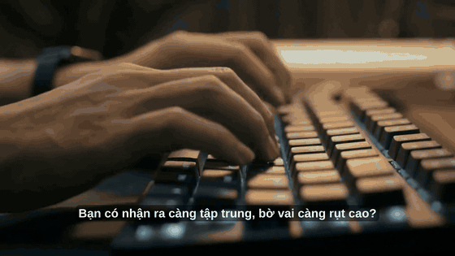
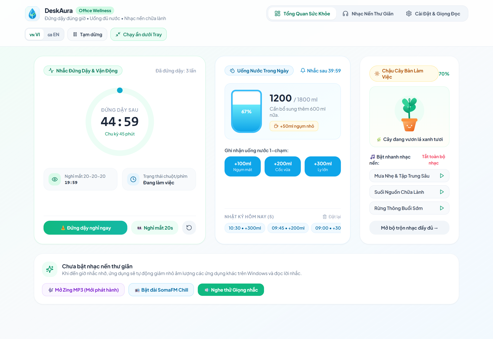
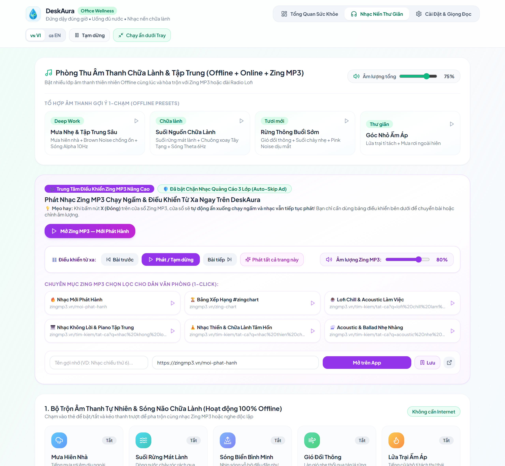
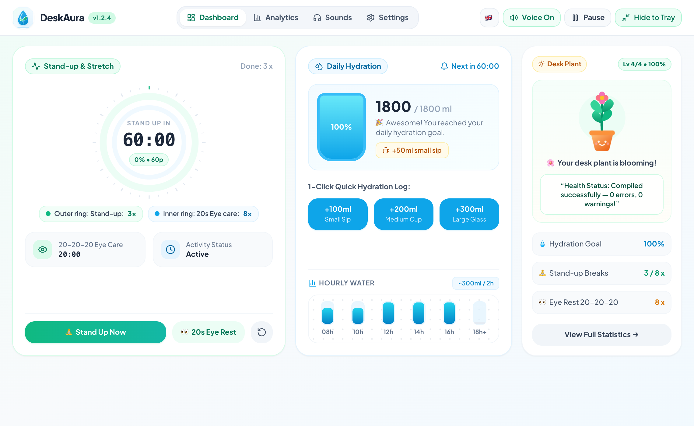
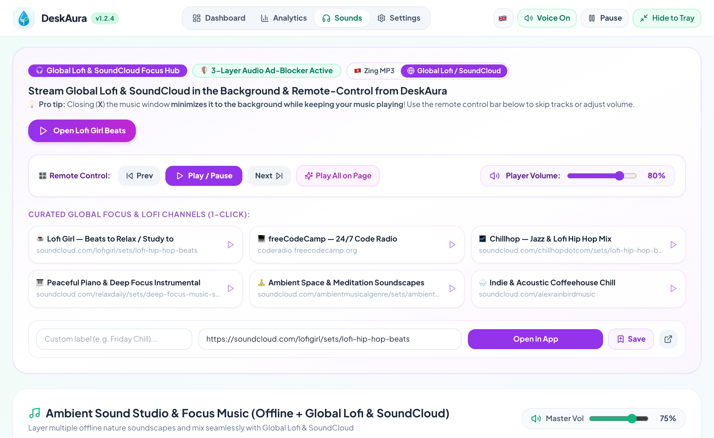

# 🌱 DeskAura v1.2.6 — Hotfix Release (Tiếng Việt & English)

> **What's New in v1.2.6** | **Tổng hợp các nâng cấp mới trong phiên bản v1.2.6**

🌟 **[▶️ Xem Video TVC Văn Phòng Mỏi Mắt (`deskaura_tvc_eyecare.mp4`)](https://github.com/duongbirken2510/deskaura/raw/main/docs/media/deskaura_tvc_eyecare.mp4)** • **[🎬 Xem Video TVC Cú Đêm IT (`deskaura_tvc_intro.mp4`)](https://github.com/duongbirken2510/deskaura/raw/main/docs/media/deskaura_tvc_intro.mp4)** • **[💻 Xem Video Demo Giao Diện 45s (`deskaura_demo_45s.mp4`)](https://github.com/duongbirken2510/deskaura/raw/main/docs/media/deskaura_demo_45s.mp4)**

---

## 🇻🇳 PHẦN 1: SỬA LỖI TRONG BẢN v1.2.6

### 🐛 Sửa Lỗi Nghỉ Mắt 20-20-20 Breathing Dimmer Không Hoạt Động (Hồi Quy từ v1.2.5)
- **Mô tả lỗi:** Tính năng **Breathing Dimmer** (màn hình tự dịu sáng 1.5 giây khi đến giờ nghỉ mắt 20-20-20) bị vô hiệu hoàn toàn trong một bản vá trước của v1.2.5. Màn hình không còn fade in-out khi kích hoạt chu kỳ nghỉ mắt.
- **Nguyên nhân gốc rễ:** Hàm `setScreenEyeFilter(fade_ms=1500)` bị gọi mỗi giây (thay vì chỉ khi trạng thái thay đổi) do `standupSecondsLeft` được thêm nhầm vào dependency array của Eye-Shield `useEffect`. Điều này làm animation 1.5 giây bị reset liên tục mỗi giây và không bao giờ hoàn thành.
- **Cách sửa:** Khôi phục `currentHourBucket` về scope ngoài `useEffect` (hoạt động đúng vì component re-render mỗi giây, nên `currentHourBucket` luôn tươi mới và chỉ trigger effect khi giá trị thực sự thay đổi theo giờ). Loại bỏ `standupSecondsLeft` khỏi dep array của Eye-Shield effect.

---

## 🇬🇧 PART 1: BUGFIXES IN v1.2.6

### 🐛 Fixed: 20-20-20 Eye Break Breathing Dimmer Not Working (Regression from v1.2.5)
- **Bug description:** The **Breathing Dimmer** feature (screen auto-dims with a 1.5-second fade when the 20-20-20 eye break countdown reaches zero) was completely broken by a previous patch in v1.2.5. The screen no longer faded in/out during eye break cycles.
- **Root cause:** `setScreenEyeFilter(fade_ms=1500)` was being called every second (instead of only on state changes) because `standupSecondsLeft` was incorrectly added to the Eye-Shield `useEffect` dependency array. This caused the 1.5-second animation to be reset every second, preventing it from ever completing.
- **Fix:** Restored `currentHourBucket` to the outer render scope (which is correct because the component re-renders every second, keeping the value fresh, and only triggers the effect when the hour actually changes). Removed `standupSecondsLeft` from the Eye-Shield effect's dependency array.

---

## 📦 Tải Về / Download v1.2.6

### 3. 🧘 Tự Động Ghi Nhận `+1 Lần Đứng Dậy` Bằng Cảm Biến Rời Máy Ở Chế Độ Nhắc Nhẹ (`Smart 180s Idle Break Credit`)
- Khi đang ở **Chế độ Nhắc nhẹ dưới Taskbar (`Gentle Mode`)** hoặc khi hiện thông báo nhắc nghỉ mà người dùng đứng dậy đi lấy nước / vận động luôn không bấm nút xác nhận:
- Nếu cảm biến phần cứng (`Native C FFI`) phát hiện không có thao tác chuột và bàn phím đủ **3 phút (`180 giây`)**, DeskAura **tự động cộng `+1 lần đứng dậy`** vào thống kê trong ngày, tự động ẩn thanh nhắc nghỉ và đặt lại đồng hồ chu kỳ 60 phút mới.

### 4. 🐧 Hỗ Trợ Chính Thức Phiên Bản Linux (`.deb` & `.AppImage`)
- Bên cạnh **Windows (`.exe`)** và **macOS Apple Silicon (`.dmg`)**, DeskAura v1.2.5 chính thức phát hành gói cài đặt tự động cho **Linux Ubuntu/Debian (`.deb`)** và **Linux Portable (`.AppImage`)** tích hợp đầy đủ cảm biến X11 (`libXss`), bộ lọc màn hình `xrandr` và tự khởi động chuẩn XDG (`~/.config/autostart/deskaura.desktop`).

### 5. ⚡ Nền Tảng Cốt Lõi Từ Các Bản v1.2.x
- **Cập nhật ngầm không popup (`Silent Background OTA` & `Two-Phase GC`):** Tự tải bản mới trong nền và tự dọn rác gói cài đặt cũ.
- **Đồng bộ đa thiết bị lai 4 tầng (`4-Tier Hybrid Sync`):** Đồng bộ tức thì `<5ms` qua mạng nội bộ Wi-Fi/LAN UDP `45888` kết hợp Google Cloud Firestore & mã 6 ký tự `Aura Code`.
- **Biểu tượng Giọt Nước dâng theo % trên System Tray / Menu Bar** & **Mã hóa lịch sử sức khỏe gắn phần cứng (`enc:v2:`)**.

---

## 🇻🇳 PHẦN 2: CÁC TÍNH NĂNG KẾ THỪA TỪ v1.2.5 (VẪN CÒN NGUYÊN)

### 1. 🛡️ Bảo Vệ Mắt & Lọc Ánh Sáng Xanh Phần Cứng (`Aura Eye-Shield`)
3 chế độ: **☀️ Tự động theo giờ / 🌿 Văn phòng / 🌙 Đêm OT** — Can thiệp trực tiếp `Hardware Gamma LUT`, `0% GPU/RAM`.

### 2. 😌 Màn Hình "Thở" Dịu Sáng 20 Giây (`Breathing Dimmer`)
Fade in-out 1.5 giây mỗi lần nghỉ mắt 20-20-20. **Đã sửa hoàn toàn trong v1.2.6.**

### 3. 🧘 Tự Động Ghi Nhận `+1 Lần Đứng Dậy` (`Smart 180s Idle Break Credit`)
Cảm biến tự cộng thống kê khi không có thao tác chuột/bàn phím đủ 3 phút.

### 4. 🐧 Hỗ Trợ Linux (`.deb` & `.AppImage`)
Đầy đủ cảm biến X11, `xrandr` gamma, XDG autostart.

---

## 🇬🇧 PART 2: WHAT'S NEW IN DESKAURA v1.2.6 (ENGLISH RELEASE NOTES)

### 🐛 Fixed: 20-20-20 Eye Break Breathing Dimmer Regression
The `setScreenEyeFilter(fade_ms=1500)` was being called every second (instead of only on actual state change) due to `standupSecondsLeft` being incorrectly added to the Eye-Shield `useEffect` dependency array in a previous patch. This caused the 1.5s fade animation to restart every second and never complete. **Now fully restored.**

### ✅ All v1.2.5 Features Carry Over
- 🛡️ **Aura Eye-Shield** — Hardware Gamma LUT, 3 circadian modes, 0% GPU
- 😌 **20s Breathing Dimmer** — 1.5s smooth fade in/out during eye breaks
- 🧘 **Smart 180s Idle Break Credit** — Auto-credits standup after 3min idle
- 🐧 **Linux Support** — `.deb` & `.AppImage` with X11, xrandr, XDG autostart

---

## 📸 Giao Diện Thực Tế / Screenshots

### 🇻🇳 Tổng Quan Sức Khỏe & Phòng Thu Zing MP3 (Vietnamese Edition)

### 🇬🇧 Wellness Dashboard & Global Lofi / SoundCloud Hub (English Edition)

---

## 👨‍💻 Tác Giả & Liên Hệ / Author & Contact

| 🇻🇳 Lời nhắn từ Tác giả | 🇬🇧 Note from the Author |
| :--- | :--- |
| **DeskAura** là dự án tâm huyết được mình phát triển và chia sẻ **hoàn toàn miễn phí** cho cộng đồng, với mong muốn giúp anh chị em văn phòng & lập trình viên bảo vệ cột sống, đôi mắt và giữ trọn sự tĩnh lặng khi làm việc sâu (*Deep Work*).  Nếu ứng dụng hữu ích với bạn, hãy tặng dự án một ngôi sao (**⭐ Star**) trên GitHub hoặc ghé thăm website của mình để kết nối và góp ý thêm nhé! | **DeskAura** is a passion project built and shared **100% free and open-source**, designed to help office workers, creators, and developers protect their spine, eyesight, and deep-work focus without intrusive interruptions.  If you find DeskAura helpful, please consider giving this repo a **⭐ Star** on GitHub or visiting my website to connect and share your feedback! |

**🌐 Website & Liên hệ / Official Website:** [**https://duongbirken.deta.vn**](https://duongbirken.deta.vn)  
**🐞 Báo lỗi & Góp ý / Issues & Feedback:** [**GitHub Issues**](https://github.com/duongbirken2510/deskaura/issues)

