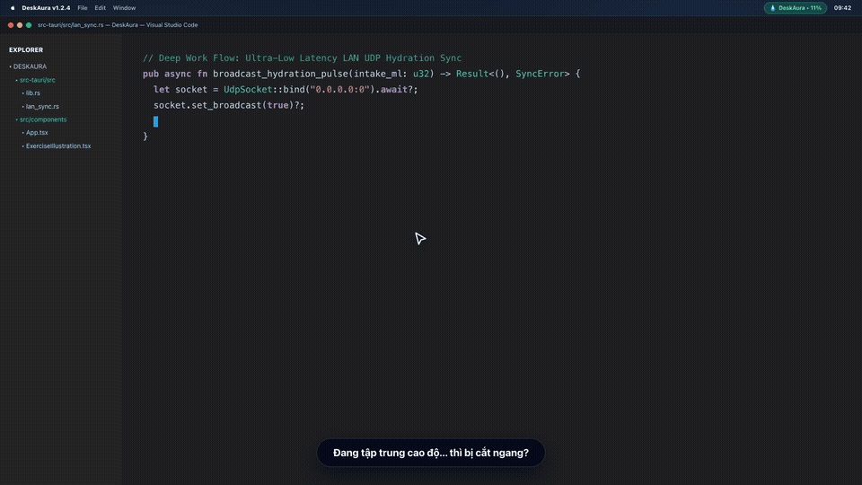
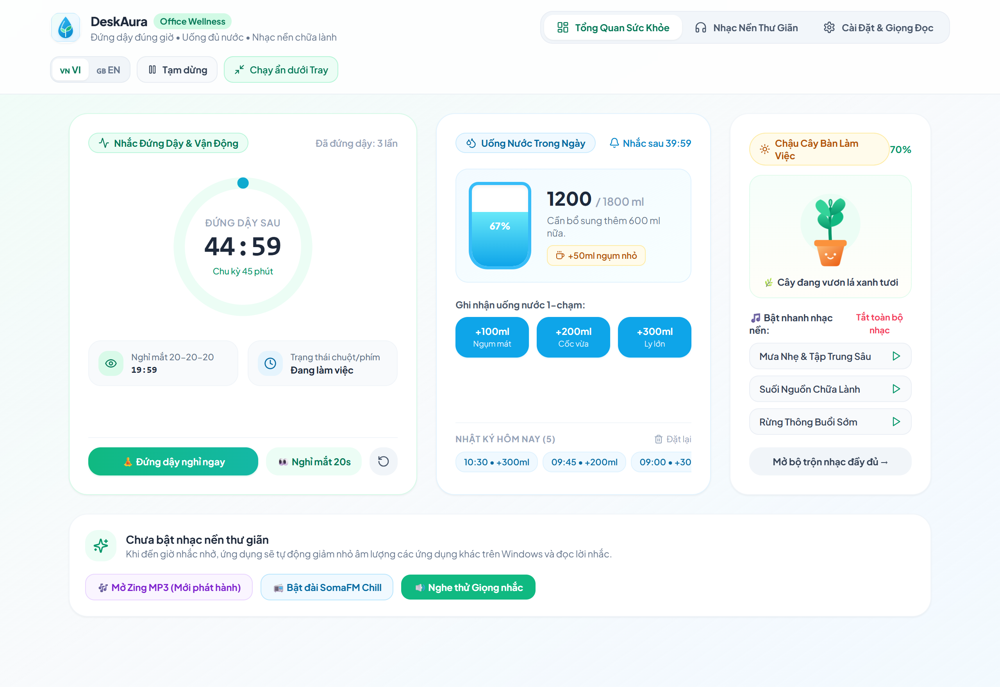
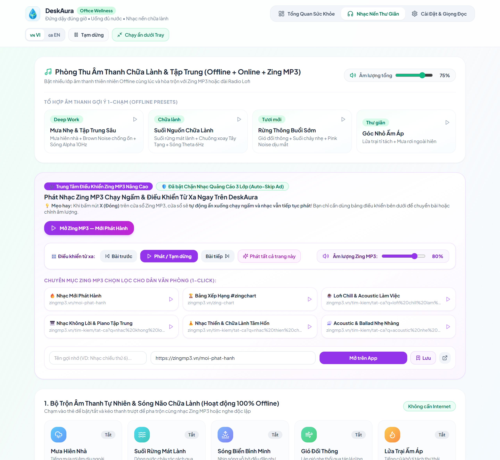
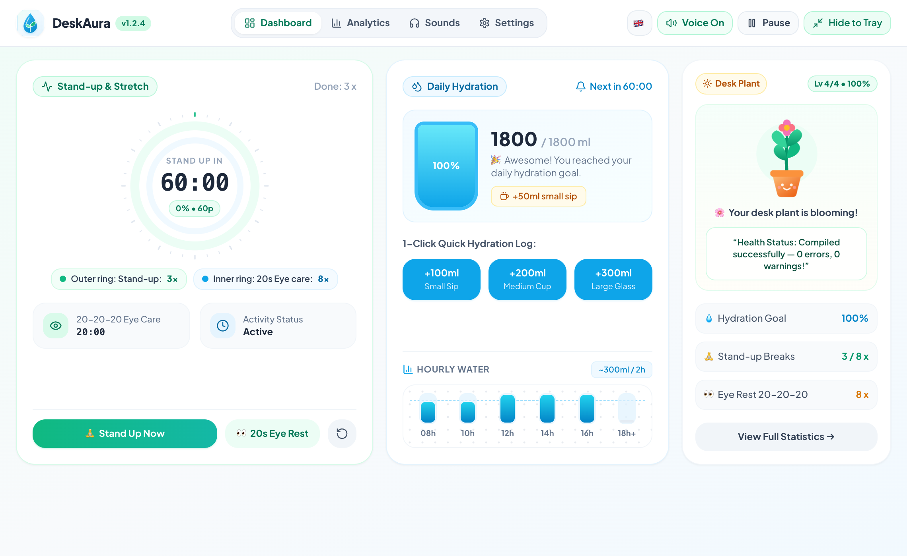
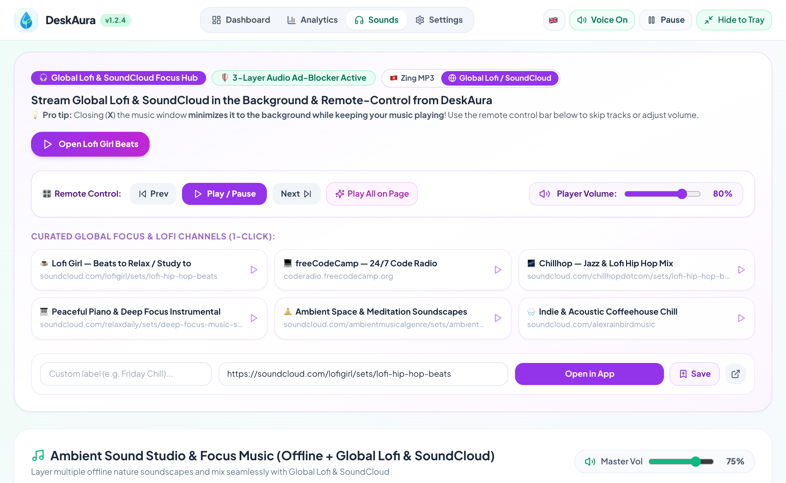

# 🌱 HỒ SƠ GIỚI THIỆU SẢN PHẨM & CÔNG NGHỆ: DESKAURA (v1.2.4)

> **Khẩu hiệu (Tagline):** *"Bảo vệ cột sống. Tôn trọng dòng code. Trợ lý sức khỏe tĩnh lặng & Không gian nhạc nền chữa lành cho dân văn phòng."*  
> **Nền tảng hỗ trợ:** Windows 10/11 (`.exe`) • macOS Apple Silicon (`.dmg`) • iOS / iPadOS (PWA & Native Mobile)  
> **Tác giả & Website chính thức:** **Duong Birken** — [https://duongbirken.deta.vn](https://duongbirken.deta.vn) *(Phát hành miễn phí & Mã nguồn mở MIT)*  
> **Kho mã nguồn & Tải về:** [https://github.com/duongbirken2510/deskaura](https://github.com/duongbirken2510/deskaura)

---

## 📑 Mục Lục Nhanh
1. [DeskAura là gì?](#1-deskaura-là-gì)
2. [Các Tính Năng Chính DeskAura Cung Cấp](#2-các-tính-năng-chính-deskaura-cung-cấp-cho-người-dùng)
3. [Lợi Ích Mang Lại — Giải Quyết Những "Nỗi Đau" Gì?](#3-lợi-ích-deskaura-mang-lại-giải-quyết-triệt-để-những-nỗi-đau-gì)
4. [Kịch Bản Thực Tế: Một Ngày Làm Việc Tiêu Biểu Cùng DeskAura](#4-kịch-bản-thực-tế-một-ngày-làm-việc-tiêu-biểu-cùng-deskaura)
5. [Kỹ Thuật & Công Nghệ Chuyên Sâu Bên Dưới](#5-kỹ-thuật--công-nghệ-chuyên-sâu-mà-deskaura-sử-dụng)
6. [Hiệu Quả Công Nghệ & Trải Nghiệm Người Dùng](#6-hiệu-quả-công-nghệ--trải-nghiệm-người-dùng-ux--performance-impact)
7. [Cam Kết Quyền Riêng Tư & Bảo Mật Tuyệt Đối (Zero-Tracking)](#7-cam-kết-quyền-riêng-tư--bảo-mật-tuyệt-đối-privacy--zero-tracking-guarantee)
8. [Thư Viện Video Demo 45s & Hình Ảnh Giao Diện Song Ngữ](#8-thư-viện-video-demo-45s--hình-ảnh-giao-diện-song-ngữ-visual-showcase)
9. [Cấu Hình Yêu Cầu & Câu Hỏi Thường Gặp (FAQ)](#9-cấu-hình-yêu-cầu--câu-hỏi-thường-gặp-khi-cài-đặt-system-requirements--faq)
10. [Lộ Trình Phát Triển Tiếp Theo & Liên Hệ Tác Giả](#10-tầm-nhìn-lộ-trình-phát-triển-future-roadmap--thông-tin-tác-giả)

---

## 1. DeskAura là gì?

**DeskAura** là ứng dụng **Trợ lý Chăm sóc Sức khỏe Văn phòng & Không gian Âm thanh Tập trung (Smart Office Wellness & Ambient Focus Companion)** thế hệ mới dành cho dân văn phòng, lập trình viên, designer và những người làm việc trí óc cường độ cao trước máy tính.

Khác biệt hoàn toàn với các phần mềm nhắc nhở truyền thống vốn thô bạo (bật hộp thoại chặn đứng màn hình, phát chuông báo giật mình làm đứt gãy luồng suy nghĩ), **DeskAura** được xây dựng trên triết lý **"Calm Technology — Công nghệ Tĩnh lặng"**:

- **Không cướp màn hình (Non-Intrusive):** Tôn trọng tuyệt đối trạng thái làm việc sâu (*Deep Work / Flow State*).
- **Chữa lành & Gamification tinh tế (Healing Gamification):** Biến thói quen uống nước, đứng dậy vươn vai và nghỉ mắt thành hành trình nuôi dưỡng một **Chậu cây ảo trên bàn làm việc** biết vui vẻ, biết khát nước, biết nở hoa và biết... buồn ngủ khi bạn thức khuya.
- **Siêu nhẹ & Gắn kết sâu với Hệ điều hành:** Viết bằng nhân **Rust (Tauri v2)** thay vì Electron, tiêu thụ tài nguyên cực thấp và hòa quyện tự nhiên vào thanh System Tray / Menu Bar của Windows và macOS.

---

## 2. Các Tính Năng Chính DeskAura Cung Cấp Cho Người Dùng

| Nhóm tính năng | Chi tiết trải nghiệm cung cấp cho người dùng |
| :--- | :--- |
| 🧘 **1. Nhắc Đổi Tư Thế & Hướng Dẫn Giãn Cơ Đa Khớp** | • Đếm ngược chu kỳ ngồi làm việc (mặc định **60 phút**) kết hợp **Vòng đếm đồng tâm kép (`Dual Activity Rings`)**. • Khi đến giờ nghỉ, hướng dẫn trực quan bằng **hoạt ảnh SVG 60fps đa khớp** với 5 bài tập chống bệnh văn phòng: *Nghiêng giãn cơ cổ*, *Mở ngực & xoay khớp vai chống gù*, *Kéo giãn cổ tay chống hội chứng ống cổ tay (RSI)*, *Vươn vai nghiêng lườn cột sống*, và *Thư giãn điều tiết mắt*. • Tùy chọn 2 chế độ nhắc: **Bung màn hình bài tập (`Overlay`)** hoặc **Chỉ nháy nhẹ Icon Giọt nước dưới Taskbar (`Gentle Mode`)**. |
| 👀 **2. Bảo Vệ Thị Lực Theo Quy Tắc Khoa Học 20-20-20** | • Cứ mỗi **20 phút** nhìn màn hình, DeskAura nhắc bạn phóng tầm mắt nhìn xa **20 feet (~6 mét)** trong **20 giây** và chớp mắt chậm 10 lần để làm ẩm giác mạc, ngăn ngừa khô mắt và cận thị văn phòng. |
| 💧 **3. Trạm Cấp Nước Thông Minh & Chậu Cây Chữa Lành** | • Tự động tính toán mục tiêu nước hàng ngày theo cân nặng (VD: `1800ml – 2000ml`). • **Ghi nhận 1-chạm (`+50ml`, `+100ml`, `+200ml`, `+300ml`)** ngay trên bảng điều khiển hoặc từ menu chuột phải ở khay hệ thống. • **Nút Hoàn tác thông minh 5 giây (`Auto-Hiding 5s Undo`):** Bấm nhầm có thể hoàn tác ngay trong 5 giây; hết 5 giây nút tự động ẩn hoàn toàn để giữ giao diện sạch sẽ. • **Chậu cây DeskAura 4 cấp độ (`Mầm non` $\rightarrow$ `Vươn lá` $\rightarrow$ `Đâm chồi` $\rightarrow$ `Nở hoa`):** Phản hồi trực tiếp theo lượng nước và số lần đứng dậy trong ngày kèm hàng chục câu thoại dí dỏm. |
| 🎵 **4. Phòng Thu Nhạc Nền Song Ngữ & Chặn Quảng Cáo** | • **Khi chọn Tiếng Việt (`🇻🇳`):** Tích hợp **Trung tâm Zing MP3 Chạy Ngầm** kèm bộ lọc **Chặn Quảng Cáo Âm Thanh 3 Lớp (`Smart Audio Ad-Guard`)**, điều khiển qua bài/tạm dừng ngay trong app mà không cần mở trình duyệt. • **Khi chọn Tiếng Anh (`🇬🇧`):** Tự động chuyển đổi sang **Global Lofi & SoundCloud Focus Hub** (*Lofi Girl, Chillhop, freeCodeCamp Code Radio, Ambient Space*). • **Bộ trộn 10 lớp âm thanh Offline (`Web Audio API`):** Mưa hiên nhà, Suối rừng, Sóng biển, Gió đồi thông, Lửa trại, Chuông xoay Tây Tạng (`432Hz/528Hz`), Sóng não `Alpha 10Hz` & `Theta 6Hz`, `Brown/Pink Noise` + phát nhạc `.mp3/.wav/.flac` từ ổ cứng. |
| 🔄 **5. Sử Dụng & Đồng Bộ Nhiều Thiết Bị Cùng Lúc** | • Người dùng vừa dùng **PC Windows ở công ty**, vừa mở **MacBook** hoặc **iPhone/iPad** sẽ được đồng bộ thời gian thực. • Hỗ trợ ghép đôi bằng **Mã nhanh 6 ký tự (`Aura Code`)**, **Tài khoản Google/Email** hoặc **tự động nhận diện qua mạng Wi-Fi/LAN nội bộ** mà không cần cấu hình. |
| 📊 **6. Thống Kê Chuyên Sâu Mebius 7 Ngày (`Analytics`)** | • Biểu đồ lượng nước uống theo từng khung giờ (`08h` $\rightarrow$ `18h+`), lịch sử Nước & Vận động 7 ngày liên tiếp, biểu đồ **Nhịp Tập Trung Sâu (`Deep Focus Flow` quy đổi số chu kỳ 🍅 Pomodoro)** và chấm điểm cân bằng sức khỏe **`Aura Index (0–100)`**. |

---

## 3. Lợi Ích DeskAura Mang Lại (Giải Quyết Triệt Để Những "Nỗi Đau" Gì?)

1. **Giải quyết nỗi đau "Bị cắt ngang luồng suy nghĩ (Broken Flow State)":**
   - *Nỗi đau:* Đang tập trung tìm bug hoặc viết tài liệu quan trọng thì một popup nhảy xổ ra giữa màn hình bắt bấm "OK" hoặc "Skip", làm mất 15–20 phút để lấy lại sự tập trung.
   - *Giải pháp của DeskAura:* Nhắc nhở bằng điểm neo thị giác, âm thanh giảm chấn êm ái, tự động hoãn khi bạn đang thuyết trình/họp toàn màn hình, và **tuyệt đối không bao giờ hiện popup đòi cập nhật phần mềm**.
2. **Giải quyết nỗi đau "Hội chứng văn phòng: Đau mỏi vai gáy, thoát vị đĩa đệm, khô mỏi mắt & sỏi thận do quên uống nước":**
   - *Nỗi đau:* Ngồi liền một mạch 4–5 tiếng quên uống nước, cuối ngày đau nhức cổ vai gáy và nhức mỏi mắt.
   - *Giải pháp của DeskAura:* Chia nhỏ mục tiêu nước theo từng khung giờ, kết hợp gộp lời nhắc uống nước vào nhịp nghỉ đứng dậy (`Combo Reminder`) và nuôi chậu cây nở hoa giúp việc chăm sóc sức khỏe trở nên vui vẻ, tự nguyện.
3. **Giải quyết nỗi đau "Bị nhắc nhở lặp lại nhiều lần khi dùng 2 máy tính cùng lúc":**
   - *Nỗi đau:* Đặt cả MacBook và PC trên bàn làm việc; vừa bấm uống nước hoặc vừa đứng dậy ở máy này xong thì 1 phút sau máy kia lại réo nhắc tiếp.
   - *Giải pháp của DeskAura:* Công nghệ đồng bộ tức thì qua mạng LAN giúp ngay khi bạn bấm `+200ml` trên MacBook, chiếc PC bên cạnh lập tức cập nhật bình nước và đặt lại đồng hồ trong chưa đầy `5 mili-giây`.
4. **Giải quyết nỗi đau "Quên bấm nút xác nhận khi tự đứng dậy đi lấy nước / đi vệ sinh":**
   - *Nỗi đau:* Bạn đã tự giác rời ghế đi pha trà 4 phút, nhưng khi quay lại bàn làm việc, phần mềm cổ điển vẫn bắt bạn phải đứng dậy lần nữa vì bạn quên bấm nút.
   - *Giải pháp của DeskAura:* Cảm biến phần cứng tự phát hiện bạn không chạm chuột/phím đủ **3 phút (`180 giây`)** sẽ tự động ghi nhận bạn đã đứng dậy nghỉ ngơi và tự làm mới chu kỳ 60 phút.
5. **Giải quyết nỗi đau "Nghe nhạc làm việc bị quảng cáo cắt ngang hoặc phần mềm ngốn RAM":**
   - *Nỗi đau:* Đang nghe nhạc tập trung thì quảng cáo phát nổ chói tai; cài thêm app nhắc nhở viết bằng Electron làm mất thêm 300–500 MB RAM.
   - *Giải pháp của DeskAura:* Trình phát nhạc ngầm tích hợp bộ lọc quảng cáo 3 lớp và toàn bộ ứng dụng chỉ tiêu tốn ~15–25 MB RAM.

---

## 4. Kịch Bản Thực Tế: Một Ngày Làm Việc Tiêu Biểu Cùng DeskAura (`A Day in the Life`)

| Khung giờ | Tình huống thực tế của người dùng | Cách DeskAura phản ứng thông minh & tinh tế |
| :--- | :--- | :--- |
| **08:30 Sáng** *(Bắt đầu ngày mới)* | Bật máy tính, mở IDE / trình duyệt để chuẩn bị làm việc. | • DeskAura tự khởi động ngầm siêu nhẹ (`~18 MB RAM`), kiểm tra bản cập nhật hoàn toàn trong bóng tối. • Bạn bật nhẹ lớp âm thanh *Mưa hiên nhà + Sóng não Alpha 10Hz* để vào guồng tập trung. |
| **10:30 Sáng** *(Họp & Thuyết trình)* | Đang chia sẻ toàn màn hình trên Zoom / Google Meet / PowerPoint với khách hàng và sếp. | • Dù đồng hồ 60 phút vừa chạm mốc `00:00`, cảm biến **`Fullscreen Guard`** phát hiện bạn đang trình chiếu toàn màn hình nên **tự động hoãn lời nhắc**, không làm bạn bối rối giữa cuộc họp. |
| **11:15 Trưa** *(Tự rời bàn đi lấy nước)* | Bạn tự đứng dậy đi pha cà phê và trò chuyện với đồng nghiệp khoảng 4 phút mà quên bấm nút trên app. | • Cảm biến **`3-Minute Natural Idle Reset`** nhận thấy chuột/phím nghỉ $\ge 180\text{s}$, tự động cộng `+1 lần đứng dậy` và đặt lại vòng đếm 60 phút mới khi bạn quay lại ghế. |
| **15:00 Chiều** *(Làm việc trên 2 máy)* | Bạn vừa uống 1 cốc nước lớn, bấm `+300ml` trên chiếc MacBook đặt cạnh dàn PC Windows. | • Trong **`< 5 mili-giây`**, gói tin **`LAN UDP Broadcast`** truyền sang chiếc PC Windows: bình nước trên cả 2 máy cùng đạt `100%`, biểu tượng **Giọt nước trên Taskbar** dâng đầy màu xanh ngọc và **Chậu cây bung nở hoa rực rỡ (Cấp 4/4)**! |
| **23:15 Đêm** *(Chạy deadline khuya)* | Bạn vẫn đang gõ code lúc hơn 11 giờ đêm trong phòng yên tĩnh. | • **Ma trận âm lượng** tự hạ nhỏ âm báo xuống `60%` để không làm giật mình. • Chậu cây tự chuyển sang giao diện đêm đầy sao **`💤 Night-Owl`**, nhắm mắt ngủ gật và nhắn: *"Sập nguồn rồi sếp ơi! Deadline có thể đợi ngày mai, nhưng sức khỏe thì không."* |

---

## 5. Kỹ Thuật & Công Nghệ Chuyên Sâu Mà DeskAura Sử Dụng

DeskAura kết hợp **9 nhóm kỹ thuật công nghệ hiện đại** ở cả tầng Hệ điều hành (Rust) và tầng Giao diện/Âm thanh (React + Web Audio):

### 5.1. Kiến trúc Nhân Rust & Tauri v2 + Giao diện Zero-Blur (`0% GPU Overhead`)
- **Backend Hệ thống (`src-tauri/src/lib.rs`):** Viết hoàn toàn bằng **Rust** trên nền tảng **Tauri v2**, giao tiếp trực tiếp với Windows Win32/COM API và macOS CoreGraphics/IOKit mà không cần đóng gói trình duyệt Chromium nặng nề.
- **Tối ưu hóa Đồ họa (`Zero-Blur Daylight & Midnight UI`):** Loại bỏ hoàn toàn các lớp `backdrop-filter: blur()` gây tiêu tốn GPU khi chạy ngầm nhiều giờ, thay bằng bảng màu bất thấu (opaque) chuẩn xác giúp mức sử dụng GPU ở trạng thái nghỉ đạt **0%**.

### 5.2. Cập Nhật Ngầm Trong Bóng Tối (`Silent Background OTA`) & Điểm Neo Thị Giác (`Subtle Visual Nudge` + `Tooltip`)
- **Cơ chế hoạt động (`stage_silent_update`):** Học hỏi triết lý của Google Chrome và VS Code — khi khởi động (sau 5 giây để không làm chậm lúc mở app) và định kỳ mỗi 30 phút, Rust backend âm thầm kiểm tra phiên bản mới trên GitHub và **tải trước toàn bộ gói cài đặt vào thư mục tạm (`%TEMP%\DeskAura_Updates` hoặc `/tmp/DeskAura_Updates`) trong nền** mà không hiện bất kỳ thanh tiến trình hay hộp thoại nào.
- **Điểm neo thị giác & Tooltip (`src/App.tsx`):** Khi gói cập nhật đã nằm sẵn trên ổ cứng, giao diện chỉ điểm xuyết một **chấm tròn xanh ngọc lục bảo (`Subtle Visual Nudge`)** trên biểu tượng `⚙️ Cài Đặt` kèm nút nhỏ trên Header. Khi người dùng rê chuột vào, **Tooltip** sẽ giải thích rõ: *"Bản cập nhật v1.2.4 đã sẵn sàng. Nhấn để khởi động lại & áp dụng"*. Người dùng toàn quyền quyết định cập nhật lúc rảnh rỗi.

### 5.3. Cơ Chế Tự Động Dọn Rác 2 Pha (`Two-Phase Update Garbage Collection`)
- **Pha 1 (`Pre-Staging Cleanup`):** Ngay trước khi tải bản cập nhật mới về thư mục tạm `DeskAura_Updates`, hệ thống tự động quét và xóa các bản tải dở dang hoặc phiên bản cũ hơn để tránh trùng lặp.
- **Pha 2 (`Boot-Time Garbage Collection` — `cleanup_old_update_files`):** Mỗi lần ứng dụng khởi động, một luồng nền (`background thread`) trong Rust tự động kiểm tra thư mục tạm của hệ điều hành và dọn sạch 100% các file `.exe` / `.dmg` cập nhật cũ còn sót lại, đảm bảo DeskAura không bao giờ để lại "rác" chiếm dụng ổ cứng của người dùng.

### 5.4. Thuật Toán Dự Báo Độ Ẩm Theo Giờ (`Time-Expected Hydration`) & Khóa Trạng Thái 100% Nước (`100% Hydrated Guard`)
- **Dự báo nhịp uống nước theo khung giờ sinh học (`expectedWaterPctByHour`):** Thay vì chỉ kiểm tra tổng lượng nước vào cuối ngày, DeskAura tính toán ngưỡng nước kỳ vọng theo từng mốc thời gian thực trong ngày (trước `10h` sáng là `0%`, `10h–14h` đạt tối thiểu `25%`, `14h–17h` đạt `50%`, sau `17h` đạt `65%`). Nếu người dùng uống chậm hơn tiến độ sinh học này hoặc ngồi liên tục quá `45 phút`, chậu cây sẽ chuyển sang trạng thái khát (`thirsty`) để nhắc nhở kịp thời.
- **Khóa bảo vệ khi đã đạt 100% mục tiêu (`100% Hydrated Guard`):** Ngay khi người dùng uống đủ `100%` mục tiêu nước trong ngày (`waterProgressPct >= 100`), hệ thống kích hoạt khóa bảo vệ: chậu cây **tuyệt đối không bao giờ** báo khát nước nữa. Nếu người dùng chưa đứng dậy lần nào (cây ở mức `75%`), bộ chọn câu thoại thông minh sẽ chuyển sang bộ lời nhắc `hydratedNeedStretch` (*"Đã nạp đủ 100% nước hôm nay! Đứng dậy vươn vai 1 lần là cây bung hoa rực rỡ ngay sếp ơi!"*).

### 5.5. Đồng Bộ Đa Thiết Bị Lai 4 Tầng (`4-Tier Hybrid Sync`) Với `Zero-Config LAN UDP (<5ms)`
- **Tầng 1 — Mạng nội bộ `Zero-Config LAN UDP Broadcast` (`src-tauri/src/lan_sync.rs`):** Sử dụng giao thức UDP Broadcast qua cổng `45888`. Khi bạn bấm uống nước hoặc hoàn thành bài tập đứng dậy trên một máy, gói tin `LanPulsePacket` được phát trực tiếp trong mạng LAN nội bộ tới các máy khác có cùng `syncKey` với độ trễ **dưới 5 mili-giây (`<5ms`)**, hoàn toàn không cần đi vòng qua máy chủ đám mây.
- **Tầng 2 & 3 — Đám mây `Firebase Firestore` & Mã `6-Digit Aura Code` (`src/services/firebaseSync.ts`):** Đồng bộ xuyên mạng Internet bằng thuật toán **Hợp nhất Nhật ký Chống trùng lặp (`Deduplicated Log Union`)** và `Math.max` trên các bộ đếm hoàn thành, đảm bảo không bao giờ bị ghi đè mất dữ liệu khi mở nhiều máy.
- **Tầng 4 — Hàng đợi Offline Mã hóa (`Offline-First Persistence`):** Tự động lưu cục bộ khi mất mạng và đồng bộ bù ngay khi có kết nối.

### 5.6. Mã Hóa Dữ Liệu Sức Khỏe Gắn Phần Cứng (`Hardware-Bound Encryption enc:v1:`)
- **Cơ chế bảo mật (`src/services/localStorageCrypto.ts`):** Toàn bộ lịch sử sức khỏe cá nhân lưu trên máy không nằm ở dạng văn bản thuần (plaintext) mà được mã hóa tự động theo chuẩn **`enc:v1:<base64>`** sử dụng luồng khóa dẫn xuất `FNV-1a / XOR Stream Cipher` gắn chặt với **Mã định danh phần cứng (`Hardware ID`)** riêng biệt của từng chiếc máy tính.
- **Di trú tự động không mất dữ liệu (`Zero-Data-Loss Migration`):** Khi nâng cấp từ các phiên bản cũ lên `v1.2.4`, bộ đọc thông minh tự động nhận diện dữ liệu JSON cũ và nâng cấp sang chuẩn mã hóa `enc:v1:` một cách trong suốt.

### 5.7. Đồ Họa Rasterizer Khay Hệ Thống Thời Gian Thực (`Procedural Liquid-Fill Water Droplet Tray Icon`)
- **Vẽ điểm ảnh trực tiếp bằng Rust (`render_tray_pie_icon`):** Thay vì dùng hàng chục file ảnh `.png` tĩnh, Rust backend tích hợp một bộ dựng hình toán học (`64x64 RGBA Pixel Buffer` với khử răng cưa `Signed-Distance Anti-Aliasing` và hàm đường cong hình học $(1 - t) \cdot \sin(\pi \cdot t^{0.62})$) để vẽ trực tiếp **Biểu tượng Giọt Nước** trên thanh Taskbar/Menu Bar. Mực chất lỏng bên trong giọt nước tự động dâng cao từ `0%` đến `100%` kèm gợn sóng và tự đổi màu theo trạng thái sức khỏe thực tế.

### 5.8. Bộ Ba Cảm Biến Ngữ Cảnh Hệ Điều Hành (`Idle 180s`, `Sleep Drift Guard`, `Fullscreen Deferral`)
- **Cảm biến rời máy tự nhiên (`Native OS Idle Detection`):** Truy vấn trực tiếp `GetLastInputInfo` (Windows) và `IOHIDSystem HIDIdleTime` (macOS). Khi người dùng rời máy $\ge 180$ giây (3 phút), DeskAura tự động hiểu người dùng vừa đứng dậy vận động và tự đặt lại bộ đếm.
- **Bảo vệ trôi đồng hồ khi máy ngủ (`OS Sleep/Hibernate Wall-Clock Drift Guard`):** Phát hiện độ lệch thời gian thực (`wall-clock drift > 15s`) khi gập/mở nắp laptop để tự động tính lại thời gian nghỉ một cách chuẩn xác.
- **Hoãn nhắc khi họp/thuyết trình (`Fullscreen Presentation Guard`):** Tự động kiểm tra cửa sổ đang chiếm toàn màn hình (`GetForegroundWindow` trên Windows / `CGWindowListCopyWindowInfo` trên macOS) để tạm hoãn bung màn hình nhắc nhở cho đến khi bạn thoát chế độ trình chiếu.

### 5.9. Kỹ Thuật Âm Thanh Thích Ứng (`WASAPI Audio Ducking`, `Time-Based Volume Matrix` & `Audio Dampening`)
- **Can thiệp âm lượng phần cứng (`Windows WASAPI Core Audio Ducking` — `src-tauri/src/audio_ducker.rs`):** Tự động hạ âm lượng của các ứng dụng khác (Spotify, YouTube, trình duyệt...) xuống `20%` trong vài giây phát giọng đọc nhắc nhở, sau đó nâng mượt mà trở lại `100%`.
- **Ma trận âm lượng theo khung giờ & Giảm chấn âm thanh (`src/services/soundEngine.ts`):** Tự động nhân hệ số giảm âm theo giờ sinh học (`100%` ban ngày $\rightarrow$ `85%` buổi tối $\rightarrow$ `60%` đêm khuya `22h–06h`), và nếu người dùng đang bật nhạc nền thư giãn trong DeskAura, âm lượng chuông/giọng nhắc tự động giảm thêm `25%` (`Audio Dampening`) để không bao giờ gây giật mình.

---

## 6. Hiệu Quả Công Nghệ & Trải Nghiệm Người Dùng (UX & Performance Impact)

| Tiêu chí đánh giá | Giải pháp truyền thống (Electron / App nhắc nhở cũ) | Hiệu quả thực tế trên **DeskAura v1.2.4** |
| :--- | :--- | :--- |
| **Dung lượng bộ cài đặt** | `120 MB – 180 MB` | Chỉ **`~2.9 MB`** (Windows `.exe`) và **`~4.3 MB`** (macOS `.dmg`). |
| **Tiêu thụ RAM & GPU khi chạy ngầm** | `250 MB – 500 MB RAM`, GPU phải liên tục xử lý hiệu ứng làm mờ. | Chỉ **`~15 MB – 25 MB RAM`**, **0% GPU overhead** nhờ kiến trúc Zero-Blur. |
| **Độ trễ đồng bộ khi dùng nhiều máy** | Không có hoặc phải chờ đồng bộ đám mây `3 – 10 giây`, dễ bị nhắc lặp 2 lần. | **`< 5 mili-giây`** qua mạng nội bộ `LAN UDP Broadcast` — uống nước ở máy này, máy kia biết ngay lập tức. |
| **Trải nghiệm khi có bản cập nhật mới** | Bật hộp thoại chặn màn hình bắt bấm "Update Now" ngay lúc đang bận. | **0 lần làm phiền:** Tải ngầm 100%, chỉ hiện chấm xanh nhỏ + Tooltip và tự động xóa sạch file rác sau khi cập nhật. |
| **Cá nhân hóa theo nhịp sinh học & ngôn ngữ** | Giao diện và âm lượng cố định suốt 24/24h. | Tự động hạ âm lượng và chuyển cây sang trạng thái **Ngủ gật (`💤 23h–04h`)** khi làm khuya; tự động chuyển đổi giữa **Zing MP3** (Tiếng Việt) và **Global Lofi & SoundCloud** (Tiếng Anh). |

---

## 7. Cam Kết Quyền Riêng Tư & Bảo Mật Tuyệt Đối (`Privacy & Zero-Tracking Guarantee`)

Vì DeskAura là công cụ đồng hành suốt ngày làm việc trên máy tính cá nhân và máy tính doanh nghiệp, ứng dụng tuân thủ **4 nguyên tắc bảo mật & quyền riêng tư nghiêm ngặt nhất**:

1. **🚫 Tuyệt đối KHÔNG ghi lại phím bấm (Zero Keylogging):** Tính năng nhận biết rời máy (`Idle Detection`) chỉ đọc duy nhất bộ đếm mili-giây nhàn rỗi của hệ điều hành (`GetLastInputInfo` trên Windows / `HIDIdleTime` trên macOS), hoàn toàn không lắng nghe hay ghi nhận bất kỳ phím gõ hay nội dung chuột nào của bạn.
2. **🚫 Tuyệt đối KHÔNG chụp màn hình hay đọc nội dung cửa sổ:** Tính năng hoãn nhắc khi họp toàn màn hình (`Fullscreen Guard`) chỉ so sánh tọa độ khung chữ nhật (`bounds`) của cửa sổ đang mở với kích thước màn hình, không bao giờ đọc tiêu đề tài liệu hay ghi hình màn hình.
3. **🔐 Mã hóa cục bộ gắn phần cứng (`Offline-First & Hardware-Encrypted`):** Nếu bạn không bật tính năng đồng bộ đám mây, 100% dữ liệu sức khỏe của bạn chỉ nằm trên ổ cứng máy tính của bạn dưới định dạng mã hóa `enc:v1:` gắn với `Hardware ID`.
4. **📖 100% Mã nguồn mở minh bạch (Open-Source MIT):** Không quảng cáo ẩn, không trình theo dõi hành vi (`Zero Telemetry`), mọi dòng code Rust và React đều công khai trên GitHub để bất kỳ chuyên gia bảo mật nào cũng có thể kiểm chứng.

---

## 8. Thư Viện Video Demo 45s & Hình Ảnh Giao Diện Song Ngữ (`Visual Showcase`)

### 🎬 Video Demo 45 Giây (1080p60)
- **File Video MP4 Full HD có âm thanh:** [`../docs/media/deskaura_demo_45s.mp4`](../docs/media/deskaura_demo_45s.mp4)
- **Ảnh động Preview:**

### 📸 Giao Diện Bản Tiếng Việt (`🇻🇳 Vietnamese Edition`)

### 📸 Giao Diện Bản Tiếng Anh (`🇬🇧 English Edition`)

---

## 9. Cấu Hình Yêu Cầu & Câu Hỏi Thường Gặp Khi Cài Đặt (`System Requirements & FAQ`)

### 💻 Cấu Hình Tối Thiểu
- **Windows:** Windows 10 (1809+) hoặc Windows 11 (64-bit), đã có sẵn `Microsoft Edge WebView2` (mặc định trên Windows 10/11), RAM trống `~25 MB`, ổ cứng trống `~15 MB`.
- **macOS:** macOS 11 Big Sur trở lên (tối ưu hóa gốc cho chip Apple Silicon `M1 / M2 / M3 / M4`).
- **iOS / iPadOS:** iOS 15+ thông qua trình duyệt Safari (*Add to Home Screen PWA*) hoặc biên dịch gói `.ipa` qua Xcode.

### ❓ Câu Hỏi Thường Gặp (FAQ)
- **Hỏi: Tại sao lần đầu mở trên Windows lại hiện thông báo màu xanh *"Windows protected your PC"* hoặc trên macOS báo *"Unverified Developer"*?**
  - **Đáp:** Vì **DeskAura** là dự án tâm huyết được tác giả chia sẻ **hoàn toàn miễn phí & phi lợi nhuận** cho cộng đồng (chưa mua chứng chỉ thương mại EV Code Signing hàng trăm USD/năm của Microsoft và Apple).
  - 👉 **Cách mở trên Windows:** Bạn chỉ cần bấm **`More info` (Thông tin thêm)** $\rightarrow$ chọn **`Run anyway` (Vẫn chạy)** ở lần mở đầu tiên.
  - 👉 **Cách mở trên macOS:** Sau khi kéo `DeskAura.app` vào `Applications`, mở **Terminal** và chạy lệnh `xattr -cr /Applications/DeskAura.app` (chỉ cần chạy 1 lần duy nhất).
- **Hỏi: Khi bấm nút Đóng (`X`) cửa sổ thì ứng dụng có bị tắt mất bộ đếm không?**
  - **Đáp:** Không! Khi bấm nút `X`, DeskAura sẽ thu gọn êm ái xuống **Biểu tượng Giọt Nước trên khay hệ thống (System Tray / Menu Bar)** để tiếp tục đếm giờ và phát nhạc nền mà không chiếm chỗ trên thanh Taskbar.

---

## 10. Tầm Nhìn, Lộ Trình Phát Triển (`Future Roadmap`) & Thông Tin Tác Giả

### 🚀 Lộ Trình Các Phiên Bản Tiếp Theo (`Roadmap`)
- **Đồng bộ lịch họp thông minh (`Calendar Sync`):** Tự động đọc trạng thái bận trên Google Calendar / Outlook để chuyển sang chế độ yên lặng trước khi cuộc họp bắt đầu.
- **Tiện ích mở rộng cho Hệ sinh thái Di động (`Apple Watch & iOS Lock Screen Widgets`):** Ghi nhận uống nước 1-chạm ngay từ mặt đồng hồ hoặc màn hình khóa điện thoại.
- **Báo cáo Sức khỏe Cuối tuần (`Weekly Wellness Digest`):** Tổng kết điểm `Aura Index`, lượng nước và số giờ tập trung sâu mỗi chiều thứ Sáu kèm huy hiệu thành tựu mới cho Chậu cây.

---

### 👨‍💻 Tác Giả & Liên Hệ / Author & Contact

| 🇻🇳 Lời nhắn từ Tác giả | 🇬🇧 Note from the Author |
| :--- | :--- |
| **DeskAura** là dự án tâm huyết được mình phát triển và chia sẻ **hoàn toàn miễn phí** cho cộng đồng, với mong muốn giúp anh chị em văn phòng & lập trình viên bảo vệ cột sống, đôi mắt và giữ trọn sự tĩnh lặng khi làm việc sâu (*Deep Work*).  Nếu ứng dụng hữu ích với bạn, hãy tặng dự án một ngôi sao (**⭐ Star**) trên GitHub hoặc ghé thăm website của mình để kết nối và góp ý thêm nhé! | **DeskAura** is a passion project built and shared **100% free and open-source**, designed to help office workers, creators, and developers protect their spine, eyesight, and deep-work focus without intrusive interruptions.  If you find DeskAura helpful, please consider giving this repo a **⭐ Star** on GitHub or visiting my website to connect and share your feedback! |

- **🌐 Website chính thức & Liên hệ tác giả:** [**https://duongbirken.deta.vn**](https://duongbirken.deta.vn)
- **📦 Kho mã nguồn & Tải bản mới nhất:** [**https://github.com/duongbirken2510/deskaura**](https://github.com/duongbirken2510/deskaura)
- **🐞 Báo lỗi & Đóng góp ý tưởng:** [**https://github.com/duongbirken2510/deskaura/issues**](https://github.com/duongbirken2510/deskaura/issues)
